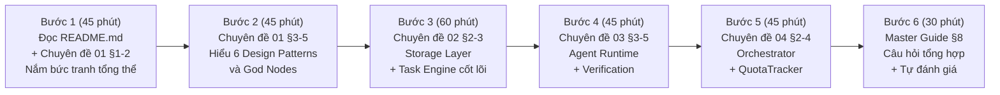
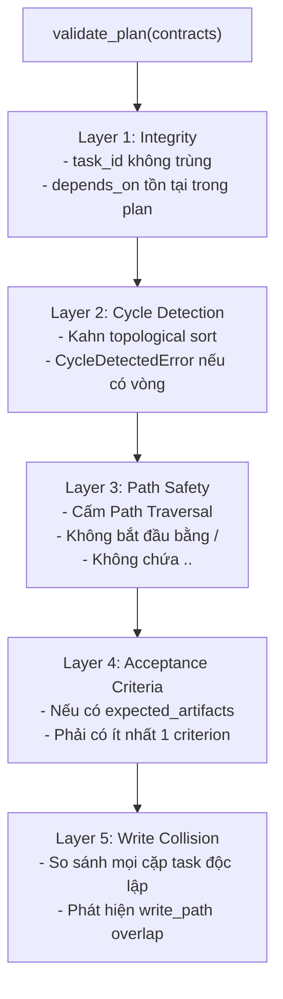
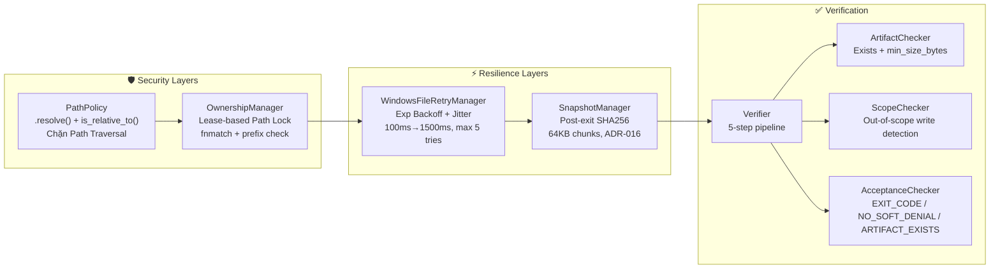
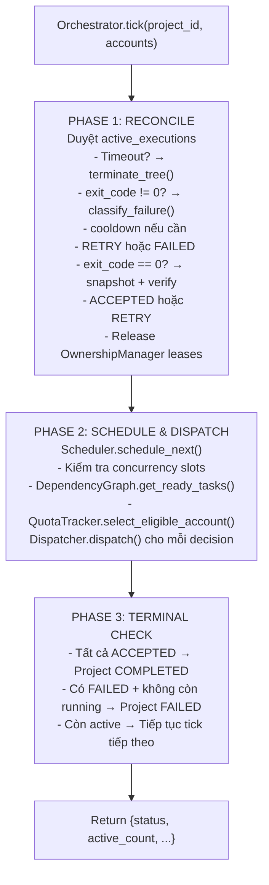
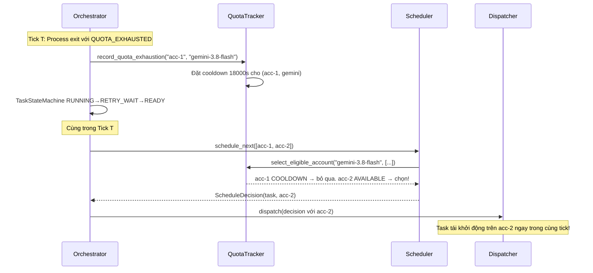
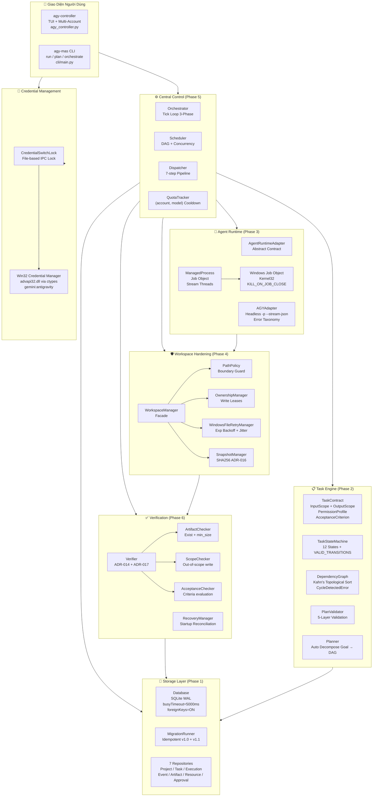

# MASTER STUDY GUIDE — AGY-MAS ARCHITECTURE & DEVELOPMENT
## Bản Đồ Học Tập Toàn Diện cho Hệ Thống Multi-Agent System

> **Phiên bản:** 1.1.0 | **Ngày biên soạn:** 2026-11-01
> **Cấu trúc học tập:** 4 chuyên đề → Progressive depth — từ kiến trúc tổng thể đến từng tầng chi tiết
> **Thời lượng học tập ước tính:** 12–16 giờ (lý thuyết + labs)

---

## MỤC LỤC MASTER GUIDE

1. [Tổng Quan Hệ Thống & Mục Tiêu Học Tập](#1-tổng-quan-hệ-thống--mục-tiêu-học-tập)
2. [Bản Đồ Kiến Trúc & Quan Hệ Giữa Các Chuyên Đề](#2-bản-đồ-kiến-trúc--quan-hệ-giữa-các-chuyên-đề)
3. [Lộ Trình Học Tập Khuyến Nghị](#3-lộ-trình-học-tập-khuyến-nghị)
4. [Tóm Tắt Nội Dung Từng Chuyên Đề](#4-tóm-tắt-nội-dung-từng-chuyên-đề)
   - 4.1. Chuyên đề 01 — Kiến trúc & Design Patterns
   - 4.2. Chuyên đề 02 — Storage Layer & Task Engine
   - 4.3. Chuyên đề 03 — Agents, Workspace & Process Isolation
   - 4.4. Chuyên đề 04 — Orchestrator, Quota & CLI Controller
5. [Sơ Đồ Tổng Hợp Kiến Trúc Đầy Đủ](#5-sơ-đồ-tổng-hợp-kiến-trúc-đầy-đủ)
6. [Bảng Tra Cứu Nhanh Toàn Hệ Thống](#6-bảng-tra-cứu-nhanh-toàn-hệ-thống)
7. [Ma Trận Kiểm Thử & Acceptance Criteria](#7-ma-trận-kiểm-thử--acceptance-criteria)
8. [Câu Hỏi Ôn Tập Tổng Hợp (Liên Chuyên Đề)](#8-câu-hỏi-ôn-tập-tổng-hợp-liên-chuyên-đề)
9. [Bài Tập Capstone — Dự Án Cuối Khóa](#9-bài-tập-capstone--dự-án-cuối-khóa)
10. [Đáp Án Gợi Ý & Hướng Dẫn Tự Đánh Giá](#10-đáp-án-gợi-ý--hướng-dẫn-tự-đánh-giá)

---

## 1. TỔNG QUAN HỆ THỐNG & MỤC TIÊU HỌC TẬP

### 1.1. AGY-MAS Là Gì?

**AGY-MAS (Antigravity Multi-Agent System)** là một hệ thống điều phối đa tác tử AI tự động hóa — biến một **mục tiêu lớn bằng ngôn ngữ tự nhiên** thành một chuỗi các tác vụ song song, được thực thi bởi nhiều AI agent (Google Antigravity CLI, Gemini, Claude, GPT) trên nhiều tài khoản, với sự kiểm soát chặt chẽ về:

- **Toàn vẹn dữ liệu** (SQLite WAL, Immutable Executions)
- **Cô lập tiến trình** (Windows Job Objects)
- **Xác minh kết quả** (Artifact Verification, ADR-014/017)
- **Quản lý tài nguyên** (Quota Tracking, Auto Failover)
- **Bảo mật workspace** (Path Policy, Write Lease)

### 1.2. Các Con Số Quan Trọng

| Metric | Giá trị | Nguồn |
|:---|:---:|:---|
| Tổng số nodes trong knowledge graph | 616 | `graphify-out/GRAPH_REPORT.md` |
| Tổng số edges | 1749 | `graphify-out/GRAPH_REPORT.md` |
| Số communities phát hiện | 34 | Graphify community detection |
| Tỉ lệ EXTRACTED / INFERRED edges | 83% / 17% | GRAPH_REPORT |
| God Node kết nối nhiều nhất | `Database` (55 edges) | GRAPH_REPORT |
| Số bảng SQLite | 10 bảng | `storage/migrations/runner.py` |
| Số Repositories | 7 chuyên biệt | `storage/repositories/` |
| Số trạng thái TaskStateMachine | 12 states | `core/state_machine.py` |
| Test coverage | 37/37 tests (100%) | `README.md` |
| Import cycles phát hiện | **0** | GRAPH_REPORT |

### 1.3. Mục Tiêu Học Tập (Learning Outcomes)

Sau khi hoàn thành toàn bộ 4 chuyên đề, học viên có khả năng:

**Cấp độ Hiểu (Understanding):**
- ✅ Giải thích được kiến trúc 6 Phase của AGY-MAS và vai trò của từng Phase
- ✅ Mô tả 12 trạng thái của `TaskStateMachine` và các điều kiện chuyển tiếp
- ✅ Giải thích tại sao `exit_code == 0` không đủ để chấp nhận tác vụ (ADR-014, ADR-017)
- ✅ Phân biệt 6 loại lỗi trong Error Taxonomy và chiến lược xử lý từng loại

**Cấp độ Áp dụng (Application):**
- ✅ Implement một `AgentRuntimeAdapter` mới cho runtime AI bất kỳ
- ✅ Thiết kế DAG task dependencies cho một dự án phần mềm thực tế
- ✅ Cấu hình `TaskContract` với đầy đủ scope, acceptance criteria và permission profile
- ✅ Sử dụng toàn bộ CLI `agy-mas` và `agy-controller`

**Cấp độ Phân tích (Analysis):**
- ✅ Chẩn đoán lỗi từ logs và event stream của hệ thống
- ✅ Nhận diện các vi phạm ADR trong code review
- ✅ Phân tích bottleneck và điểm nghẽn trong luồng thực thi

**Cấp độ Thiết kế (Design):**
- ✅ Mở rộng hệ thống với runtime mới mà không thay đổi Orchestrator
- ✅ Thiết kế chiến lược quota management cho môi trường đa tài khoản phức tạp
- ✅ Đề xuất cải tiến kiến trúc dựa trên trade-off analysis

---

## 2. BẢN ĐỒ KIẾN TRÚC & QUAN HỆ GIỮA CÁC CHUYÊN ĐỀ

```mermaid
flowchart TD
    subgraph GD01["📘 Chuyên đề 01: Kiến trúc & Design Patterns"]
        A1["Modular Monolith Architecture"]
        A2["6 Design Patterns"]
        A3["ADR-009 đến ADR-017"]
        A4["God Nodes & Communities"]
        A5["State Machine Overview"]
    end

    subgraph GD02["📗 Chuyên đề 02: Storage Layer & Task Engine"]
        B1["Database + WAL Pragmas"]
        B2["MigrationRunner Idempotent"]
        B3["7 Repositories (DAL)"]
        B4["10 ERD Tables"]
        B5["TaskContract + PermissionProfile"]
        B6["TaskStateMachine 12 States"]
        B7["DependencyGraph Kahn Sort"]
        B8["PlanValidator 5-Layer"]
    end

    subgraph GD03["📙 Chuyên đề 03: Agents, Workspace & Process Isolation"]
        C1["AgentRuntimeAdapter (Abstract)"]
        C2["ManagedProcess + Windows Job Objects"]
        C3["AGYAdapter + Error Taxonomy"]
        C4["PathPolicy Boundary Guard"]
        C5["WindowsFileRetryManager WinError 32/33"]
        C6["OwnershipManager Write Leases"]
        C7["SnapshotManager ADR-016"]
        C8["Verifier ADR-014 & ADR-017"]
    end

    subgraph GD04["📕 Chuyên đề 04: Orchestrator, Quota & CLI"]
        D1["Orchestrator Tick Loop 3 Phases"]
        D2["Scheduler DAG + Concurrency"]
        D3["Dispatcher Credential Switch"]
        D4["QuotaTracker Lazy Expiration"]
        D5["Auto Failover QUOTA-01"]
        D6["agy-controller TUI & CredentialSwitchLock"]
        D7["agy-mas CLI Subcommands"]
        D8["3-Tier Config Hierarchy"]
    end

    GD01 -->|"Nền tảng kiến trúc"| GD02
    GD01 -->|"Nền tảng kiến trúc"| GD03
    GD02 -->|"State Machine + Repositories"| GD04
    GD03 -->|"Adapter + Workspace"| GD04
    B6 -->|"12 States"| D1
    B7 -->|"DAG ready tasks"| D2
    C2 -->|"ManagedProcess"| D3
    C3 -->|"classify_failure"| D4
    C6 -->|"OwnershipManager"| D3
    C7 -->|"SnapshotManager"| D1
    C8 -->|"Verifier"| D1
```



---

## 3. LỘ TRÌNH HỌC TẬP KHUYẾN NGHỊ

### 3.1. Lộ Trình Nhanh (4 giờ) — Nắm bắt toàn cảnh



### 3.2. Lộ Trình Chuyên Sâu (12-16 giờ) — Hiểu toàn diện

| Ngày | Nội dung | Thời lượng | Files |
|:---|:---|:---:|:---|
| **Ngày 1** | Chuyên đề 01: Kiến trúc & Patterns | 3-4h | `01_architecture_and_design_patterns.md` |
| **Ngày 2** | Chuyên đề 02: Storage + SQLite Hands-On | 3-4h | `02_storage_and_task_engine.md` |
| **Ngày 3** | Chuyên đề 03: Agents + Windows Hardening | 3-4h | `03_agents_workspace_and_process_isolation.md` |
| **Ngày 4** | Chuyên đề 04: Orchestrator + CLI Labs | 3-4h | `04_orchestrator_quota_and_cli.md` |
| **Ngày 5** | Master Guide: Ôn tập + Capstone Lab | 3h | `00_master_study_guide.md` |

### 3.3. Thứ Tự Ưu Tiên Đọc Code

Nếu muốn đọc source code theo thứ tự hiểu kiến trúc từ nền lên:

```
1. src/agy_mas/config.py                    ← Cấu hình hệ thống
2. src/agy_mas/storage/database.py          ← Kết nối DB + Pragmas
3. src/agy_mas/storage/migrations/runner.py ← Schema initialization
4. src/agy_mas/planning/plan_schema.py      ← TaskContract definition
5. src/agy_mas/core/state_machine.py        ← 12-state lifecycle
6. src/agy_mas/planning/dependency_graph.py ← Kahn's Algorithm
7. src/agy_mas/planning/plan_validator.py   ← 5-layer validation
8. src/agy_mas/agents/base.py               ← Adapter interface
9. src/agy_mas/workspace/path_policy.py     ← Boundary guard
10. src/agy_mas/agents/process_manager.py   ← Windows Job Objects
11. src/agy_mas/agents/adapters/agy_adapter.py ← Real adapter + taxonomy
12. src/agy_mas/workspace/workspace_manager.py ← Facade
13. src/agy_mas/verification/verifier.py    ← ADR-014 & ADR-017
14. src/agy_mas/resources/quota_tracker.py  ← Quota management
15. src/agy_mas/core/scheduler.py           ← DAG scheduling
16. src/agy_mas/core/dispatcher.py          ← Process launching
17. src/agy_mas/core/orchestrator.py        ← Central tick loop
18. src/agy_mas/cli/main.py                 ← CLI entrypoint
19. agy_controller.py                       ← Multi-account controller
```

---

## 4. TÓM TẮT NỘI DUNG TỪNG CHUYÊN ĐỀ

### 4.1. Chuyên Đề 01 — Kiến Trúc & Design Patterns

📄 **File:** [`01_architecture_and_design_patterns.md`](01_architecture_and_design_patterns.md)

**Trọng tâm:**
- Bức tranh toàn cảnh 6 Phase architecture
- 6 Design Patterns: Repository, State Machine, Adapter, Facade, Strategy, Observer
- 6 ADR cốt lõi (ADR-009 đến ADR-017)
- God Nodes & Community analysis từ graphify
- Full execution sequence diagram (19 bước)

**Khái niệm chìa khóa:**

| Khái niệm | Định nghĩa ngắn gọn |
|:---|:---|
| Modular Monolith | Các module độc lập về logic nhưng chạy cùng 1 Python process |
| Single Source of Truth | SQLite là nguồn trạng thái duy nhất; RAM chỉ là cache |
| God Node | Node kết nối nhiều nhất — `Database` (55 edges), `ResourceRepository` (41 edges) |
| ADR-014 | Soft-denial = Failure signal, dù exit code là 0 |
| ADR-016 | Snapshot SHA256 chỉ sau khi process tree đã thoát hoàn toàn |
| ADR-017 | Task chỉ được ACCEPTED khi toàn bộ artifacts hợp lệ trên đĩa |

---

### 4.2. Chuyên Đề 02 — Storage Layer & Task Engine

📄 **File:** [`02_storage_and_task_engine.md`](02_storage_and_task_engine.md)

**Trọng tâm:**
- SQLite WAL + 3 Pragma tối quan trọng (foreign_keys, busy_timeout, journal_mode)
- Thread-Local Connection Pattern + Transaction Context Manager
- MigrationRunner idempotent + PRAGMA table_info strategy
- ERD đầy đủ 10 bảng
- 7 Repositories với trách nhiệm cụ thể
- TaskContract với 4 thành phần (InputScope, OutputScope, AcceptanceCriterion, PermissionProfile)
- 12-state TaskStateMachine với VALID_TRANSITIONS matrix
- Kahn's Algorithm trong DependencyGraph
- PlanValidator 5-layer (Integrity → Cycle → Path Safety → Acceptance Criteria → Write Collision)

**Khái niệm chìa khóa:**

| Khái niệm | Chi tiết |
|:---|:---|
| WAL Mode | Write-Ahead Logging: Nhiều reader + 1 writer không block nhau |
| busy_timeout | 5000ms — chờ tối đa 5s khi DB bị lock trước khi ném lỗi |
| Immutable Executions | `UNIQUE(task_id, attempt)` — attempt# tăng đơn điệu, không bao giờ update |
| Monotonic Events | `UNIQUE(project_id, sequence)` — sequence không ngắt quãng |
| Kahn's Algorithm | BFS-based topological sort + cycle detection khi `len(sorted) < total_nodes` |
| Write Collision | Hai task độc lập cùng write_path → PlanValidator ném lỗi ngay |

**Sơ đồ 5-Layer PlanValidator:**



---

### 4.3. Chuyên Đề 03 — Agents, Workspace & Process Isolation

📄 **File:** [`03_agents_workspace_and_process_isolation.md`](03_agents_workspace_and_process_isolation.md)

**Trọng tâm:**
- `AgentRuntimeAdapter` abstract contract + 5 DTO (RuntimeCapabilities, Invocation, RuntimeEvent, FailureClassification, TerminationResult)
- `ManagedProcess` + Windows Job Objects (ctypes.WinDLL kernel32)
- 2-layer process termination (Kernel Job Object + taskkill /F /T)
- Non-blocking async stream reading (daemon threads)
- `AGYAdapter.build_invocation()` — Headless print mode, stream-json, model/effort hierarchy
- `classify_failure()` — 2-phase priority (Structured Event → Regex Fallback)
- `PathPolicy` — .resolve() + is_relative_to() boundary check
- `WindowsFileRetryManager` — Exponential Backoff + Jitter
- `OwnershipManager` — Lease-based path locking, fnmatch + prefix matching
- `SnapshotManager` — ADR-016 post-exit SHA256 with 64KB chunk reading
- Verification Pipeline — 5-step verify_task() implementation
- `CredentialSwitchLock` + Staggered Startup 0.4s

**Sơ đồ Workspace Hardening:**



---

### 4.4. Chuyên Đề 04 — Orchestrator, Quota & CLI

📄 **File:** [`04_orchestrator_quota_and_cli.md`](04_orchestrator_quota_and_cli.md)

**Trọng tâm:**
- `Orchestrator.tick()` — 3-Phase: Reconcile → Schedule → Terminal Check
- Active Executions Reconciliation — Timeout guard + failure classification
- `Scheduler.schedule_next()` — Concurrency check, DAG ready tasks, eligible account
- `Dispatcher.dispatch()` — 7-step dispatch pipeline
- `QuotaTracker` — Per `(account_id, model_key)` cooldown
- `record_quota_exhaustion()` — Lazy Expiration (no background threads)
- Auto Failover QUOTA-01 — `RUNNING → RETRY_WAIT → READY` in same tick
- `agy_controller.py` — Win32 Credential Manager via ctypes/advapi32
- `CredentialSwitchLock` — File-based inter-process lock + 0.4s staggered startup
- 3-Tier Config Hierarchy (Task > Account > Orchestrator Policy)
- `agy-mas run` one-command autonomous workflow

**Sơ đồ Tick Loop 3-Phase:**



**Luồng Auto Failover QUOTA-01:**



---

## 5. SƠ ĐỒ TỔNG HỢP KIẾN TRÚC ĐẦY ĐỦ



---

## 6. BẢNG TRA CỨU NHANH TOÀN HỆ THỐNG

### 6.1. Classes & Modules

| Class / Module | File | Chuyên đề | Chức năng chính |
|:---|:---|:---:|:---|
| `Database` | `storage/database.py` | 02 | SQLite connection, WAL, thread-local, transaction |
| `MigrationRunner` | `storage/migrations/runner.py` | 02 | Idempotent schema upgrade |
| `ProjectRepository` | `storage/repositories/project_repo.py` | 02 | CRUD projects |
| `TaskRepository` | `storage/repositories/task_repo.py` | 02 | CRUD tasks + dependency DAG |
| `ExecutionRepository` | `storage/repositories/execution_repo.py` | 02 | Immutable execution records |
| `EventRepository` | `storage/repositories/event_repo.py` | 02 | Monotonic event stream |
| `ArtifactRepository` | `storage/repositories/artifact_repo.py` | 02 | SHA256 artifact registry |
| `ResourceRepository` | `storage/repositories/resource_repo.py` | 02 | Locks, leases, quota cooldown |
| `ApprovalRepository` | `storage/repositories/approval_repo.py` | 02 | Human-in-the-loop approvals |
| `TaskContract` | `planning/plan_schema.py` | 02 | Task specification dataclass |
| `PermissionProfile` | `planning/plan_schema.py` | 02 | `allows_write()` with fnmatch + prefix |
| `TaskStateMachine` | `core/state_machine.py` | 02, 04 | 12-state transition guard |
| `DependencyGraph` | `planning/dependency_graph.py` | 02 | Kahn's topo sort + cycle detection |
| `PlanValidator` | `planning/plan_validator.py` | 02 | 5-layer plan validation |
| `Planner` | `planning/planner.py` | 02 | Auto goal → task decomposition |
| `AgentRuntimeAdapter` | `agents/base.py` | 03 | Abstract adapter interface |
| `AGYAdapter` | `agents/adapters/agy_adapter.py` | 03 | Google Antigravity headless CLI |
| `ManagedProcess` | `agents/process_manager.py` | 03 | Windows Job Object supervisor |
| `PathPolicy` | `workspace/path_policy.py` | 03 | Workspace boundary enforcement |
| `WindowsFileRetryManager` | `workspace/file_lock_manager.py` | 03 | WinError 32/33 retry backoff |
| `OwnershipManager` | `workspace/ownership_manager.py` | 03 | Path lease management |
| `SnapshotManager` | `workspace/snapshot_manager.py` | 03 | Post-exit SHA256 (ADR-016) |
| `WorkspaceManager` | `workspace/workspace_manager.py` | 03 | Facade: PP + OM + FLM + SM |
| `Verifier` | `verification/verifier.py` | 03 | 5-step acceptance pipeline |
| `ArtifactChecker` | `verification/artifact_checker.py` | 03 | Existence + size validation |
| `ScopeChecker` | `verification/scope_checker.py` | 03 | Out-of-scope write detection |
| `AcceptanceChecker` | `verification/acceptance_checker.py` | 03 | Criteria rule evaluation |
| `QuotaTracker` | `resources/quota_tracker.py` | 04 | `(account, model)` cooldown |
| `Scheduler` | `core/scheduler.py` | 04 | DAG + concurrency slot selection |
| `Dispatcher` | `core/dispatcher.py` | 04 | 7-step process launch pipeline |
| `Orchestrator` | `core/orchestrator.py` | 04 | Central 3-phase tick loop |
| `RecoveryManager` | `recovery/recovery_manager.py` | 04 | Startup reconciliation |

### 6.2. Lệnh CLI Tra Cứu Nhanh

**`agy-mas` CLI:**

| Lệnh | Mô tả |
|:---|:---|
| `agy-mas run "<goal>"` | Full autonomous: plan → validate → orchestrate |
| `agy-mas project create` | Tạo dự án mới |
| `agy-mas plan <project_id>` | Tự động phân rã mục tiêu thành TaskContract DAG |
| `agy-mas task create <proj> <id> "<title>"` | Tạo task thủ công |
| `agy-mas task list <project_id>` | Liệt kê tasks kèm trạng thái |
| `agy-mas orchestrate start <proj> --accounts` | Khởi chạy multi-agent loop |
| `agy-mas resource status` | Xem quota cooldown status |

**`agy-controller` CLI:**

| Lệnh | Mô tả |
|:---|:---|
| `agy-controller` | Mở TUI tương tác |
| `agy-controller list` | Liệt kê tài khoản + Model/Effort/Mode |
| `agy-controller switch <N>` | Chuyển account nhanh |
| `agy-controller config <N> --model --effort --mode` | Cấu hình account |
| `agy-controller check-all` | Kiểm tra tất cả token (static) |
| `agy-controller check <N>` | Kiểm tra sâu + auto-refresh token |
| `agy-controller run-many -w 1 "<prompt>"` | Chạy song song nhiều worker |

### 6.3. ADR Quick Reference

| ADR | Quyết định | Hệ quả |
|:---|:---|:---|
| **ADR-009** | Headless print mode `-p` + `--output-format stream-json` | Agent chạy tự động 100% |
| **ADR-010** | Structured Event ưu tiên trước Regex Pattern | Chính xác hơn trong phân loại lỗi |
| **ADR-013** | Scoped permissions mặc định | Bảo mật workspace by default |
| **ADR-014** | **Soft-denial = Failure** | exit code 0 + soft-denial → FAILED, không ACCEPTED |
| **ADR-016** | **Snapshot sau khi process tree thoát hoàn toàn** | Tránh unflushed buffers + WinError 32 |
| **ADR-017** | **ACCEPTED chỉ khi artifacts hợp lệ trên đĩa** | Chống file ma 0 bytes và kết quả giả |

---

## 7. MA TRẬN KIỂM THỬ & ACCEPTANCE CRITERIA

### 7.1. Bộ Test Suite (37/37 Passing)

| Test File | Scope | Số Tests | Acceptance IDs |
|:---|:---|:---:|:---|
| `test_storage.py` | Migrations, FKs, Transactions, 7 Repos | ~8 | — |
| `test_task_engine.py` | TaskContract, DAG cycles, Write collisions | ~6 | — |
| `test_planner.py` | Auto decompose, Contract validity, Cycle detection | ~4 | — |
| `test_agy_adapter.py` | Headless flags, stream-json, Error taxonomy | ~5 | — |
| `test_workspace.py` | Path isolation, WinError 32 retry, Snapshot timing | ~6 | WIN-01 |
| `test_orchestrator.py` | DAG 2-task loop, Auto failover quota | ~4 | QUOTA-01 |
| `test_verification_recovery.py` | Verification pipeline, Orphan process recovery | ~4 | VER-01,02,03; REC-01 |
| `test_e2e_acceptance.py` | End-to-end v1.1 Architecture | 6 | VER-01,02,03; QUOTA-01; WIN-01; REC-01 |

### 7.2. Integration Acceptance Criteria

| ID | Kịch bản | Kết quả kỳ vọng |
|:---|:---|:---|
| **VER-01** | Task hoàn thành, artifacts đủ, không soft-denial | → `ACCEPTED` |
| **VER-02** | Soft-denial trong stdout, exit code = 0 | → Bị từ chối (ADR-014), không ACCEPTED |
| **VER-03** | Exit code 0 nhưng artifact thiếu/kích thước < min_size | → FAILED (ADR-017) |
| **QUOTA-01** | Cạn quota acc-1, còn acc-2 khả dụng | → Task tự động failover sang acc-2 trong cùng tick |
| **WIN-01** | `WinError 32` khi đọc file | → Retry backoff đến 5 lần, ném `FileSharingContentionError` sau đó |
| **REC-01** | Worker crash, Orchestrator khởi động lại | → `RecoveryManager` phát hiện dead PID, release leases, reset task state |

---

## 8. CÂU HỎI ÔN TẬP TỔNG HỢP (LIÊN CHUYÊN ĐỀ)

### Nhóm A — Kiến Trúc Tổng Thể

**A1.** Vẽ sơ đồ (không nhìn tài liệu) các Phase của AGY-MAS với tên module chính của từng Phase. Kiểm tra lại bằng `README.md`.

**A2.** Giải thích tại sao `0 import cycles` (từ GRAPH_REPORT) là một chỉ số kiến trúc tốt. Điều gì xảy ra khi có import cycle?

**A3.** Tại sao hệ thống chọn SQLite thay vì PostgreSQL hay Redis? Liệt kê ít nhất 3 ưu điểm trong ngữ cảnh của AGY-MAS chạy trên Windows.

**A4.** So sánh cách `Orchestrator` (Phase 5) và `PlanValidator` (Phase 2) đều đảm bảo không có write collision. Tại sao cần **cả hai** lớp bảo vệ?

### Nhóm B — Data Flow & State

**B1.** Trace đầy đủ đường đi của dữ liệu từ lúc user chạy `agy-mas run "Build REST API"` đến lúc project đạt trạng thái `COMPLETED`. Liệt kê theo thứ tự các bước.

**B2.** Một `ExecutionRecord` có thể cập nhật `attempt` sau khi đã được tạo không? Tại sao? (Gợi ý: xem `UNIQUE(task_id, attempt)` constraint)

**B3.** Mô tả chính xác sequence khi một task chuyển từ `RUNNING → RETRY_WAIT → READY` do `QUOTA_EXHAUSTED`. Những gì được ghi vào DB trong mỗi bước?

**B4.** Tại sao `EventRepository` dùng `sequence` tự tăng (monotonic) thay vì timestamp? Timestamp có vấn đề gì trong môi trường đa tiến trình?

### Nhóm C — Windows Hardening

**C1.** Bạn đang debug và phát hiện một subprocess đang chạy mặc dù Orchestrator đã gọi `terminate()`. Giải thích tại sao điều này xảy ra và cách Windows Job Objects giải quyết.

**C2.** Điều gì xảy ra nếu `SnapshotManager` chụp SHA256 khi tiến trình vẫn còn sống (vi phạm ADR-016)? Liệt kê 2 loại lỗi cụ thể có thể xảy ra.

**C3.** Giải thích tại sao `jitter_ratio = ±20%` trong Exponential Backoff lại quan trọng. Vấn đề gì xảy ra nếu jitter = 0?

**C4.** Vẽ timeline của 2 workers (W1 chạy acc-1, W2 chạy acc-2) được launch cách nhau 0.4s qua `CredentialSwitchLock`. Tại sao 0.4s là đủ?

### Nhóm D — Error Handling & Recovery

**D1.** Một task bị `AUTHENTICATION_FAILED`. `retryable=False`. Điều gì xảy ra với task đó? Cần hành động gì từ người dùng để tiếp tục?

**D2.** So sánh `QUOTA_EXHAUSTED` (cooldown 5h) và `RATE_LIMITED` (cooldown 60s): Tại sao có sự khác biệt về thời gian cooldown này?

**D3.** `RecoveryManager` được gọi khi nào? Nó phát hiện dead PID bằng cách nào và thực hiện những hành động gì để phục hồi trạng thái?

**D4.** Nếu `PlanValidator` không tồn tại, mô tả ít nhất 2 kịch bản runtime lỗi có thể xảy ra khi 2 task độc lập cùng write vào một file.

### Nhóm E — Design & Trade-offs

**E1.** Tại sao `classify_failure()` ưu tiên Structured Event JSON trước Regex Pattern? Hãy tạo một ví dụ cụ thể khi Regex Pattern cho kết quả sai nhưng Structured Event cho kết quả đúng.

**E2.** `QuotaTracker.is_in_cooldown()` dùng "Lazy Expiration" — không có background thread. Ưu điểm là gì? Có nhược điểm gì không?

**E3.** Tại sao `TaskStateMachine.transition()` là **class method** (không phải instance method)? Điều này ảnh hưởng như thế nào đến testability?

**E4.** `WorkspaceManager` là Facade. Nếu thêm thành phần mới `ChecksumVerifier`, bạn cần thay đổi những gì? Những gì **không** cần thay đổi?

---

## 9. BÀI TẬP CAPSTONE — DỰ ÁN CUỐI KHÓA

### Capstone: Thiết Kế Hệ Thống CI/CD Multi-Agent

**Bài toán:** Bạn cần dùng AGY-MAS để tự động hóa quy trình CI/CD cho một dự án Python:

1. **Task 1 (SETUP):** Cài đặt dependencies (`pip install -r requirements.txt`)
2. **Task 2 (LINT, ĐỘCLẬP):** Chạy linter (`flake8 src/`)
3. **Task 3 (TEST, phụ thuộc SETUP):** Chạy test suite (`pytest tests/ --cov`)
4. **Task 4 (BUILD, phụ thuộc TEST + LINT):** Build artifact (`python setup.py sdist`)
5. **Task 5 (DEPLOY, phụ thuộc BUILD):** Deploy lên staging server

**Yêu cầu thiết kế:**

**Phần A — TaskContracts (15 điểm):**
Viết đầy đủ `TaskContract` cho mỗi task, bao gồm:
- `InputScope` (paths cần đọc, parameters như model/effort)
- `OutputScope` với `ExpectedArtifact` (path, artifact_type, min_size_bytes, required)
- `AcceptanceCriterion` phù hợp
- `PermissionProfile` với `write_paths` không gây write collision

**Phần B — DAG Validation (10 điểm):**
Vẽ đồ thị DAG của 5 tasks. Xác định:
- Những cặp task nào có thể chạy song song?
- `PlanValidator` Layer 5 (Write Collision) sẽ kiểm tra những cặp nào?
- Với `max_concurrency=3`, thứ tự tối ưu để hoàn thành nhanh nhất là gì?

**Phần C — Error Handling (10 điểm):**
Mô tả xử lý cho 3 kịch bản lỗi:
1. Task 3 (TEST) gặp `QUOTA_EXHAUSTED` trên acc-1
2. Task 4 (BUILD) tạo ra artifact nhỏ hơn `min_size_bytes`
3. Task 5 (DEPLOY) gặp `WinError 32` khi đọc file build

**Phần D — Monitoring (5 điểm):**
Viết query để lấy:
- Tất cả events của dự án theo thứ tự
- Tổng số attempts cho mỗi task
- Danh sách tasks đang trong `RETRY_WAIT`

---

## 10. ĐÁP ÁN GỢI Ý & HƯỚNG DẪN TỰ ĐÁNH GIÁ

### Đáp Án Câu Hỏi Ôn Tập (Chọn Lọc)

**A2 — Import Cycles:**
Import cycle (A → B → A) khiến Python không thể resolve module loading order, dẫn đến `ImportError` hoặc các attribute chưa được define khi import. Kiến trúc phân tầng rõ ràng (Storage → Planning → Agents → Orchestration) với dependency chỉ đi một chiều là điều kiện cần thiết cho zero import cycles. GRAPH_REPORT xác nhận đây là thực tế của codebase.

**B4 — Timestamp vs Sequence:**
Timestamp có vấn đề trong môi trường đa tiến trình vì:
1. **Clock skew**: Hai tiến trình trên cùng máy có thể có microsecond offset
2. **Non-unique**: Nếu 2 events xảy ra trong cùng millisecond, timestamp trùng nhau
3. **Non-monotonic**: System clock có thể được điều chỉnh ngược (NTP sync, DST)
Monotonic sequence (`MAX(sequence)+1` trong transaction) đảm bảo unique và không ngắt quãng.

**C3 — Jitter trong Backoff:**
Nếu jitter = 0: Giả sử 10 tiến trình đều gặp `WinError 32` cùng lúc. Tất cả sẽ retry sau đúng 100ms, 200ms, 400ms... → **Thundering Herd Problem**: Chúng lại đồng loạt va chạm vào cùng một thời điểm, tạo thêm áp lực thay vì giảm. Jitter ±20% phân tán các lần thử ra ngẫu nhiên, phá vỡ vòng lặp đồng bộ.

**E2 — Lazy Expiration Trade-offs:**
- **Ưu**: Không cần background thread (tiết kiệm tài nguyên, đơn giản), không có race condition giữa cron job và query
- **Nhược**: Cooldown không được giải phóng chính xác tại thời điểm `cooldown_until`. Nếu không có request nào gọi `is_in_cooldown()`, cooldown "tưởng tượng" vẫn active trong DB nhưng không ảnh hưởng thực tế. Là trade-off chấp nhận được vì Orchestrator tick() gọi Scheduler liên tục.

### Rubric Tự Đánh Giá

| Mức độ | Tiêu chí |
|:---|:---|
| **Xuất sắc (90-100%)** | Trả lời chính xác, có ví dụ code cụ thể, giải thích trade-offs |
| **Tốt (75-89%)** | Trả lời đúng khái niệm, thiếu một số chi tiết kỹ thuật |
| **Đạt (60-74%)** | Hiểu đại ý nhưng còn nhầm lẫn về flow hoặc constraint cụ thể |
| **Cần ôn lại (<60%)** | Quay lại đọc chuyên đề tương ứng và chạy labs |

---

> [!TIP]
> **Phương pháp học hiệu quả nhất:** Đọc tài liệu → Đọc code tương ứng → Chạy tests → Tự giải thích lại bằng lời → Làm Lab → Câu hỏi ôn tập. Lặp lại 3 vòng là đủ để nắm vững kiến trúc.

> [!NOTE]
> **Knowledge Graph hỗ trợ học tập:** Khi muốn hiểu sâu một khái niệm, dùng `graphify query "How does X work?"` hoặc `graphify explain "ClassName"` để lấy context từ toàn bộ codebase thay vì chỉ đọc một file đơn lẻ.

---

*Master Study Guide biên soạn từ: `docs/study_guide/02_storage_and_task_engine.md`, `docs/study_guide/03_agents_workspace_and_process_isolation.md`, `docs/study_guide/04_orchestrator_quota_and_cli.md`, `graphify-out/GRAPH_REPORT.md`, và `README.md`.*
