# GIÁO TRÌNH KIẾN TRÚC & PHÁT TRIỂN AGY-MAS
## CHUYÊN ĐỀ 01: KIẾN TRÚC TỔNG THỂ & DESIGN PATTERNS

> **Phiên bản tài liệu:** 1.1.0
> **Phạm vi mã nguồn:** [`src/agy_mas/`](file:///C:/Users/TOAN%20PHUC/Desktop/project/multi-agy-tool/src/agy_mas/), [`agy_controller.py`](file:///C:/Users/TOAN%20PHUC/Desktop/project/multi-agy-tool/agy_controller.py), [`README.md`](file:///C:/Users/TOAN%20PHUC/Desktop/project/multi-agy-tool/README.md)
> **Mục tiêu chuyên đề:** Cung cấp bức tranh toàn cảnh về kiến trúc hệ thống AGY-MAS, các design patterns cốt lõi, quyết định kiến trúc (ADR), và sự phối hợp giữa các tầng phân lớp — làm nền tảng vững chắc để đọc các chuyên đề chuyên sâu 02–04.

---

## MỤC LỤC TỔNG QUAN

1. [Giới Thiệu & Bối Cảnh Bài Toán](#1-giới-thiệu--bối-cảnh-bài-toán)
2. [Kiến Trúc Phân Tầng 6 Phase](#2-kiến-trúc-phân-tầng-6-phase)
   - 2.1. Sơ đồ tổng thể & vai trò từng tầng
   - 2.2. Nguyên tắc Modular Monolith
3. [Các Design Patterns Cốt Lõi](#3-các-design-patterns-cốt-lõi)
   - 3.1. Repository Pattern & Data Access Layer
   - 3.2. State Machine Pattern
   - 3.3. Adapter Pattern (AgentRuntimeAdapter)
   - 3.4. Facade Pattern (WorkspaceManager)
   - 3.5. Strategy Pattern (Error Taxonomy)
   - 3.6. Observer Pattern (Event Sourcing)
4. [Các Quyết Định Kiến Trúc (ADR)](#4-các-quyết-định-kiến-trúc-adr)
5. [God Nodes & Điểm Kết Nối Trung Tâm](#5-god-nodes--điểm-kết-nối-trung-tâm)
6. [Sơ Đồ Quan Hệ Thực Thể (ERD Tổng Quát)](#6-sơ-đồ-quan-hệ-thực-thể-erd-tổng-quát)
7. [Các Nguyên Lý Thiết Kế Cốt Lõi](#7-các-nguyên-lý-thiết-kế-cốt-lõi)
8. [Thách Thức Kỹ Thuật & Giải Pháp Windows-Specific](#8-thách-thức-kỹ-thuật--giải-pháp-windows-specific)
9. [Câu Hỏi Ôn Tập](#9-câu-hỏi-ôn-tập)
10. [Bài Tập Thực Hành](#10-bài-tập-thực-hành)

---

## 1. GIỚI THIỆU & BỐI CẢNH BÀI TOÁN

Hệ thống **AGY-MAS** (*Antigravity Multi-Agent System*) được xây dựng với mục tiêu biến các mô hình trí tuệ nhân tạo (Google Antigravity CLI, Gemini, Claude, GPT) từ những công cụ lập trình đơn lẻ thành một **hệ thống đa tác tử tự động hóa hoàn toàn** — có khả năng phân rã mục tiêu lớn, phân công nhiều agent chạy song song, kiểm soát xung đột tài nguyên và tự động phục hồi khi có sự cố.

Hệ thống được thiết kế đặc biệt cho **môi trường Windows**, nơi có những thách thức đặc thù mà các hệ thống Linux/macOS không gặp:

| Thách thức | Biểu hiện | Giải pháp kiến trúc |
|:---|:---|:---|
| **Khóa tệp độc quyền** | `WinError 32`, `WinError 33` | `WindowsFileRetryManager` + Exponential Backoff |
| **Tiến trình mồ côi** | Zombie Process Trees | Windows Job Objects (`JOB_OBJECT_LIMIT_KILL_ON_JOB_CLOSE`) |
| **Ảo giác thành công** | Exit code 0 nhưng không làm gì | ADR-014 (Soft-denial) + ADR-017 (Artifact Verification) |
| **Race condition credential** | Cross-account credential poisoning | `CredentialSwitchLock` + Staggered Startup 0.4s |
| **Cạn hạn ngạch đột ngột** | Quota Exhaustion giữa chừng | `QuotaTracker` + Lazy Expiration + Auto Failover |

---

## 2. KIẾN TRÚC PHÂN TẦNG 6 PHASE

### 2.1. Sơ Đồ Tổng Thể & Vai Trò Từng Tầng

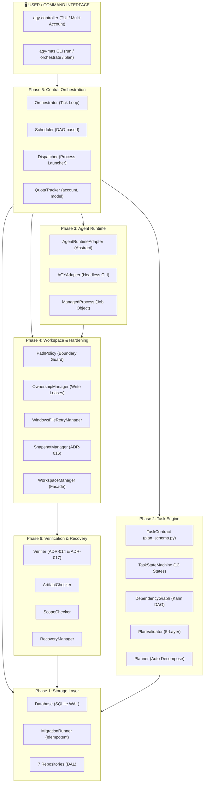

### 2.2. Nguyên Tắc Modular Monolith

AGY-MAS theo mô hình **Modular Monolith** — không phải Microservices:

- **Một tiến trình điều phối duy nhất** (`Orchestrator`) nắm toàn bộ trạng thái hệ thống.
- **SQLite WAL** là nguồn chân lý duy nhất (Single Source of Truth), không có message broker hay distributed cache.
- **Các module độc lập về logic** nhưng chạy trong cùng Python process — đảm bảo zero network latency giữa các tầng.
- **Kiểm thử dễ dàng**: Thiết kế Tick-based State Machine (không dùng infinite while loop) giúp unit test từng bước chuyển trạng thái.

Cấu trúc thư mục `src/agy_mas/`:

```
src/agy_mas/
├── config.py                  # Cấu hình runtime, quota, retry, storage
├── storage/                   # Phase 1: Database & Repositories
│   ├── database.py
│   ├── migrations/
│   └── repositories/          # 7 repos: project, task, execution, event, artifact, resource, approval
├── core/                      # Phase 5: Central Control
│   ├── state_machine.py
│   ├── scheduler.py
│   ├── dispatcher.py
│   └── orchestrator.py
├── planning/                  # Phase 2: Task Engine
│   ├── plan_schema.py
│   ├── dependency_graph.py
│   └── plan_validator.py
├── agents/                    # Phase 3: Agent Runtime
│   ├── base.py
│   ├── process_manager.py
│   └── adapters/agy_adapter.py
├── workspace/                 # Phase 4: Workspace Hardening
│   ├── path_policy.py
│   ├── file_lock_manager.py
│   ├── ownership_manager.py
│   ├── snapshot_manager.py
│   └── workspace_manager.py
├── resources/                 # Phase 3+5: Quota Management
│   └── quota_tracker.py
├── verification/              # Phase 6: Acceptance Pipeline
│   ├── artifact_checker.py
│   ├── scope_checker.py
│   ├── acceptance_checker.py
│   └── verifier.py
├── recovery/                  # Phase 6: Crash Recovery
│   └── recovery_manager.py
└── cli/                       # CLI Entrypoint
    └── main.py
```

---

## 3. CÁC DESIGN PATTERNS CỐT LÕI

### 3.1. Repository Pattern & Data Access Layer

Toàn bộ thao tác I/O với SQLite được đóng gói bên trong **7 Repositories chuyên biệt**, hoàn toàn tách biệt khỏi logic nghiệp vụ:

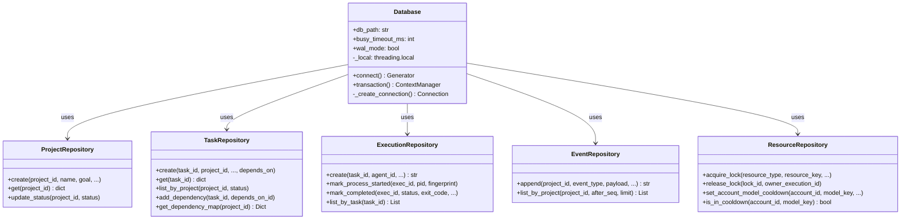

**Ưu điểm kiến trúc:**
- Business logic (Orchestrator, Planner) không biết gì về SQL
- Dễ viết unit test (mock repository)
- `ExecutionRepository.create()` tự động tính `attempt = MAX(attempt) + 1` nguyên tử, bảo đảm không có số lần thử trùng lặp

### 3.2. State Machine Pattern

[`TaskStateMachine`](file:///C:/Users/TOAN%20PHUC/Desktop/project/multi-agy-tool/src/agy_mas/core/state_machine.py#L28) kiểm soát vòng đời tác vụ qua **12 trạng thái nghiêm ngặt**:

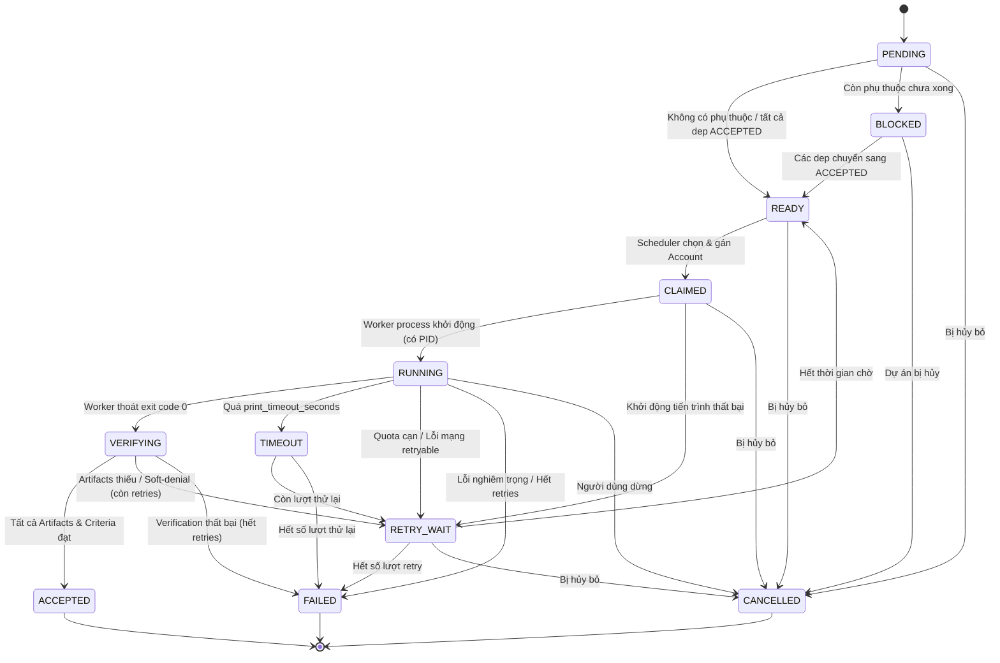

**Ma trận chuyển trạng thái hợp lệ** (trích từ `VALID_TRANSITIONS` dict):

| Từ | Tới (hợp lệ) |
|:---|:---|
| `PENDING` | `READY`, `BLOCKED`, `CANCELLED` |
| `BLOCKED` | `READY`, `CANCELLED` |
| `READY` | `CLAIMED`, `CANCELLED` |
| `CLAIMED` | `RUNNING`, `RETRY_WAIT`, `CANCELLED` |
| `RUNNING` | `VERIFYING`, `RETRY_WAIT`, `FAILED`, `TIMEOUT`, `CANCELLED` |
| `VERIFYING` | `ACCEPTED`, `RETRY_WAIT`, `FAILED` |
| `RETRY_WAIT` | `READY`, `FAILED`, `CANCELLED` |
| `TIMEOUT` | `RETRY_WAIT`, `FAILED` |
| `ACCEPTED` | *(Terminal - không có chuyển tiếp)* |
| `FAILED` | *(Terminal - không có chuyển tiếp)* |
| `CANCELLED` | *(Terminal - không có chuyển tiếp)* |

> [!IMPORTANT]
> Mọi chuyển trạng thái bất hợp lệ (ví dụ: `PENDING → ACCEPTED`) sẽ ném ngay ngoại lệ [`InvalidStateTransitionError`](file:///C:/Users/TOAN%20PHUC/Desktop/project/multi-agy-tool/src/agy_mas/core/state_machine.py#L23). Đồng thời, mỗi lần chuyển thành công tự động ghi một sự kiện `TASK_STATE_{target}` vào `EventRepository` (Event Hook pattern).

### 3.3. Adapter Pattern — `AgentRuntimeAdapter`

Lớp trừu tượng [`AgentRuntimeAdapter`](file:///C:/Users/TOAN%20PHUC/Desktop/project/multi-agy-tool/src/agy_mas/agents/base.py#L56-L88) định nghĩa giao diện chuẩn, cho phép hệ thống hoán đổi runtime AI mà không cần sửa Orchestrator:

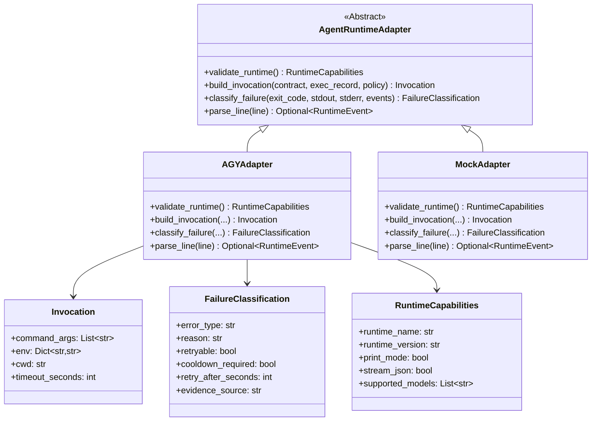

**Ưu điểm**: Orchestrator chỉ biết `AgentRuntimeAdapter`, không phụ thuộc vào `agy` CLI cụ thể. `MockAdapter` được dùng trong toàn bộ unit tests.

### 3.4. Facade Pattern — `WorkspaceManager`

[`WorkspaceManager`](file:///C:/Users/TOAN%20PHUC/Desktop/project/multi-agy-tool/src/agy_mas/workspace/workspace_manager.py#L14-L61) là **điểm tiếp xúc duy nhất** (Single Entry Point) cho mọi thao tác workspace:

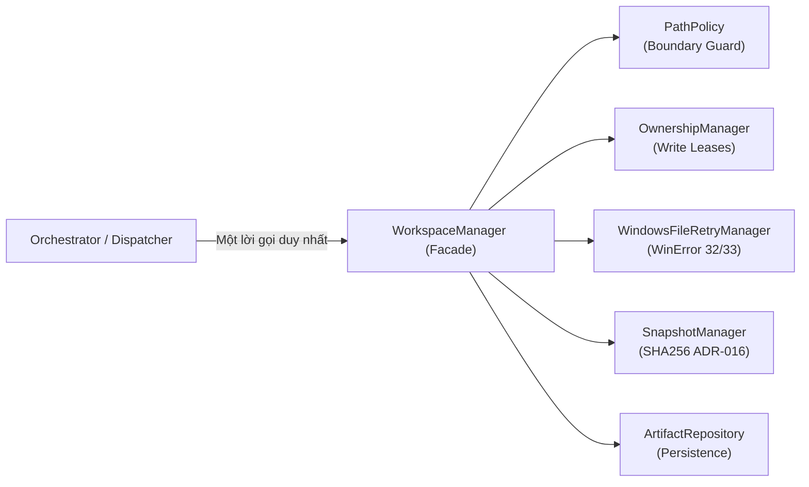

`WorkspaceManager.register_task_artifacts()` tự động:
1. Snapshot SHA256 của tất cả `expected_artifacts` (sau khi tiến trình đã thoát)
2. Lưu bền vững vào bảng `artifacts` trong SQLite
3. Giải phóng `OwnershipManager` leases

### 3.5. Strategy Pattern — Error Taxonomy

[`AGYAdapter.classify_failure()`](file:///C:/Users/TOAN%20PHUC/Desktop/project/multi-agy-tool/src/agy_mas/agents/adapters/agy_adapter.py#L172-L256) áp dụng chiến lược phân loại **2 giai đoạn ưu tiên** (ADR-010):

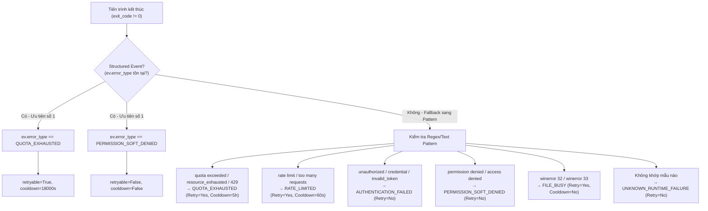

**Bảng Error Taxonomy đầy đủ:**

| Error Type | Retryable | Cooldown | Cooldown Scope | Giải thích |
|:---|:---:|:---:|:---|:---|
| `QUOTA_EXHAUSTED` | ✅ | ✅ | `(account, model)` | Cạn ngạch ngày/phút. Auto-failover sang account khác. |
| `RATE_LIMITED` | ✅ | ✅ | `(account, model)` | Tần suất gọi quá nhanh. Chờ 60s. |
| `AUTHENTICATION_FAILED` | ❌ | ✅ | `account` | Token hết hạn. Cần login lại. |
| `PERMISSION_SOFT_DENIED` | ❌ | ❌ | — | CLI bị chặn quyền trong headless mode. |
| `FILE_BUSY` | ✅ | ❌ | `path` | `WinError 32`. Retry với backoff jitter. |
| `PROCESS_TIMEOUT` | ❌ | ❌ | — | Vượt `timeout_seconds`. Job Object kết liễu. |
| `UNKNOWN_RUNTIME_FAILURE` | ❌ | ❌ | — | Lỗi không xác định. |

### 3.6. Observer Pattern — Event Sourcing

[`EventRepository`](file:///C:/Users/TOAN%20PHUC/Desktop/project/multi-agy-tool/src/agy_mas/storage/repositories/event_repo.py) triển khai **Monotonic Event Stream**:

- Mỗi sự kiện có `sequence = MAX(sequence) + 1` tăng đơn điệu không ngắt quãng trong từng dự án
- Ràng buộc `UNIQUE(project_id, sequence)` ở tầng DB
- Phục vụ: Event Sourcing, audit trail, real-time UI, crash recovery

---

## 4. CÁC QUYẾT ĐỊNH KIẾN TRÚC (ADR)

| ADR | Nội dung Quyết định | Tác động |
|:---|:---|:---|
| **ADR-009** | Headless print mode (`agy -p --output-format stream-json`) | Agent chạy tự động 100%, không cần tương tác bàn phím |
| **ADR-010** | Structured Event ưu tiên trước Regex Pattern trong phân loại lỗi | Chính xác hơn khi nhà cung cấp có structured error output |
| **ADR-013** | Scoped permissions mặc định; chỉ mở Turbo khi có chỉ định rõ ràng | Bảo mật workspace mặc định |
| **ADR-014** | **Soft-denial trong Headless execution là Failure Signal** | Exit code 0 nhưng có soft-denial → Task FAILED, không được ACCEPTED |
| **ADR-016** | **Chỉ snapshot SHA256 sau khi cây tiến trình Worker đã thoát hoàn toàn** | Tránh unflushed buffers và WinError 32 khi chụp checksum |
| **ADR-017** | **Task phải qua thẩm định Artifact độc lập mới được ACCEPTED** | Ngăn chặn "file ma" 0 bytes và kết quả giả |

> [!CAUTION]
> **ADR-014 & ADR-017 là tường thành chống gian lận kết quả.** Trong LLM-based agents, exit code 0 không có nghĩa là thành công — agent có thể in "Tôi không có quyền làm điều này" và CLI vẫn thoát với code 0. Hai ADR này đảm bảo mọi `ACCEPTED` state đều có bằng chứng vật lý trên đĩa.

---

## 5. GOD NODES & ĐIỂM KẾT NỐI TRUNG TÂM

Từ phân tích knowledge graph (graphify-out), các **God Nodes** — điểm kết nối nhiều nhất trong hệ thống:

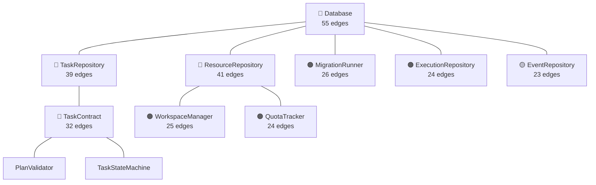

> [!NOTE]
> `Database` có betweenness centrality cao nhất (0.156) — là cầu nối giữa tất cả các community. Đây là lý do tại sao mọi Repository đều nhận `Database` qua dependency injection, không tạo instance Database trực tiếp.

**5 Community chính (từ Graphify Community Detection):**

| Community | Hub Node | Số Nodes | Mô tả |
|:---|:---|:---:|:---|
| `agy_controller.py` | `agy_controller.py` | 47 | Multi-account CLI & TUI |
| `TaskContract` | `TaskContract` | 15 | Task Engine & Planning |
| `orchestrator.py` | `orchestrator.py` | 11 | Central Control Loop |
| `PathPolicy` | `PathPolicy` | 7 | Verification & Workspace |
| `ResourceRepository` | `ResourceRepository` | 5 | Quota & Ownership |

---

## 6. SƠ ĐỒ QUAN HỆ THỰC THỂ (ERD TỔNG QUÁT)

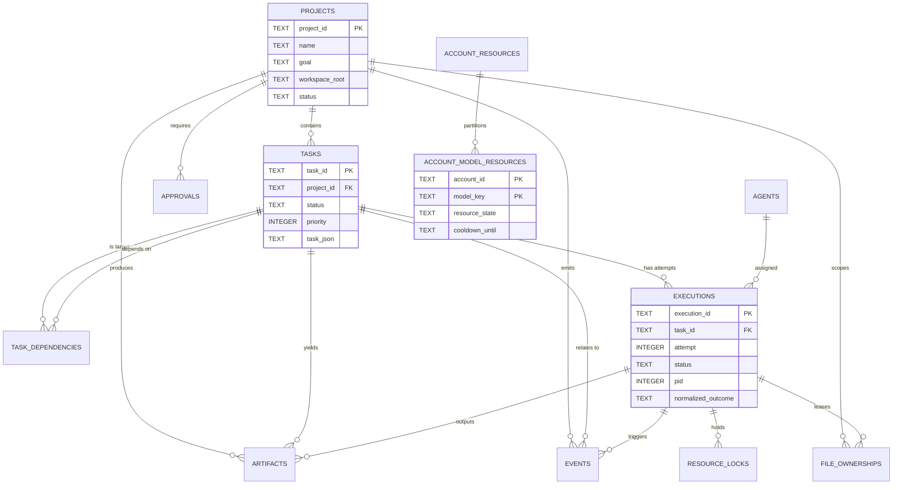

**10 bảng dữ liệu cốt lõi:**

| # | Bảng | Đặc điểm nổi bật |
|:---:|:---|:---|
| 1 | `schema_migrations` | Idempotent migration tracking |
| 2 | `projects` | Root entity, lưu `workspace_root` và `policy_json` |
| 3 | `tasks` | DAG node, toàn bộ `TaskContract` trong `task_json` |
| 4 | `task_dependencies` | DAG edges, `CHECK(task_id <> depends_on_task_id)` |
| 5 | `agents` | Runtime registry |
| 6 | `executions` | **Immutable** — `UNIQUE(task_id, attempt)`, monotonic attempt# |
| 7 | `artifacts` | SHA256 checksum, `min_size_bytes` validation |
| 8 | `events` | **Monotonic** — `UNIQUE(project_id, sequence)` |
| 9 | `resource_locks` & `file_ownerships` | Lease-based với `expires_at` auto-cleanup |
| 10 | `account_model_resources` | Granular quota: `PRIMARY KEY(account_id, model_key)` |

---

## 7. CÁC NGUYÊN LÝ THIẾT KẾ CỐT LÕI

### 7.1. Bốn Trụ Cột Kiến Trúc

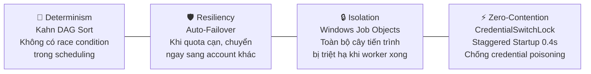

### 7.2. Ba Nguyên Lý Thiết Kế Bổ Sung

1. **Single Source of Truth**: Mọi trạng thái chỉ được xác định qua SQLite. RAM là bộ đệm tạm thời.
2. **Idempotency**: Migration, state transition và artifact registration đều có thể chạy lại nhiều lần mà không làm hỏng trạng thái cuối đúng.
3. **Deterministic DAG Scheduling**: Thứ tự ưu tiên tác vụ được suy diễn hoàn toàn toán học (Kahn's Algorithm), không phụ thuộc vào timing ngẫu nhiên.

### 7.3. Luồng Thực Thi Đầy Đủ Một Tác Vụ

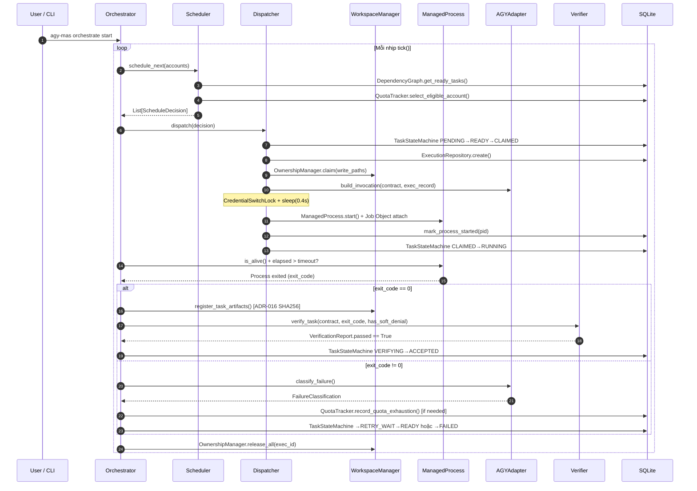

---

## 8. THÁCH THỨC KỸ THUẬT & GIẢI PHÁP WINDOWS-SPECIFIC

### 8.1. Windows Job Objects — Giải Pháp Triệt Căn Tiến Trình Mồ Côi

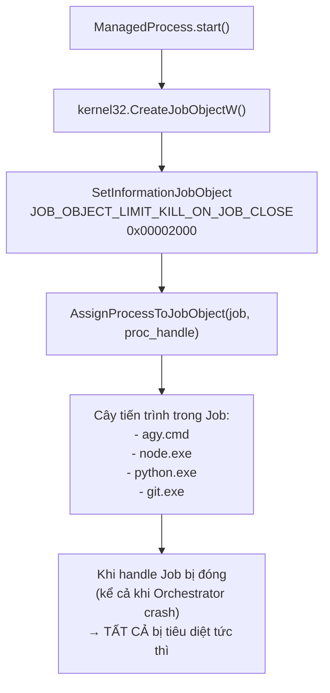

Cơ chế tiêu diệt **2 lớp** (`terminate_tree()`):
1. **Kernel Level**: `kernel32.TerminateJobObject(job_handle, 1)` — tức thì, không cần PID list
2. **OS Fallback**: `taskkill /F /T /PID <pid>` — đảm bảo quét lại toàn bộ OS process list

### 8.2. Exponential Backoff với Jitter — Chống Thundering Herd

$$\text{delay} = \min\Big(\text{max\_delay\_ms},\ \text{delay\_ms} \times 2^{k} \times (1 + \text{jitter})\Big)$$

| Tham số | Giá trị | Mục đích |
|:---|:---:|:---|
| `initial_delay_ms` | 100ms | Lần thử đầu tiên |
| `max_delay_ms` | 1500ms | Ngưỡng trần |
| `max_attempts` | 5 | Số lần thử tối đa |
| `jitter_ratio` | ±20% | Phân tán thời gian, tránh đồng loạt thử lại |

### 8.3. CredentialSwitchLock & Staggered Startup

**Bài toán:** 4 agent cùng lúc ghi vào `gemini:antigravity` (Credential Manager duy nhất) → **Cross-account credential poisoning**.

**Giải pháp:**
```
with CredentialSwitchLock():    # File-based inter-process lock
    switch_credential_to(account_id)
    process = ManagedProcess(invocation)
    process.start()
    time.sleep(0.4)             # Grace period: agy đọc token vào RAM
# Lock được giải phóng → Worker tiếp theo có thể switch account
```

Sau 0.4s, `agy` đã load token vào bộ nhớ RAM của tiến trình riêng. Từ lúc đó trở đi, mỗi worker hoạt động hoàn toàn độc lập với Credential Manager.

---

## 9. CÂU HỎI ÔN TẬP

### Câu hỏi mức Hiểu (Understanding)

1. **[Kiến trúc]** Tại sao AGY-MAS chọn mô hình **Modular Monolith** thay vì Microservices? Kể tên 2 ưu điểm cụ thể trong ngữ cảnh hệ thống này.

2. **[Pattern]** `WorkspaceManager` áp dụng design pattern nào? Giải thích tại sao pattern này phù hợp với vai trò điều phối 4 thành phần con (PathPolicy, OwnershipManager, FileRetryManager, SnapshotManager).

3. **[ADR]** Giải thích bằng ví dụ cụ thể tại sao **ADR-014** (Soft-denial = Failure) là bắt buộc trong hệ thống agent LLM. Điều gì xảy ra nếu không có ADR này?

4. **[State Machine]** Một tác vụ đang ở trạng thái `RUNNING` có thể chuyển sang những trạng thái nào? Kể tên và giải thích điều kiện của từng chuyển tiếp.

5. **[God Nodes]** `Database` có 55 edges trong knowledge graph. Điều này nói lên điều gì về vai trò kiến trúc của lớp này? Tại sao `Database` không nên bị loại bỏ hay gom vào một lớp khác?

### Câu hỏi mức Phân tích (Analysis)

6. **[Error Taxonomy]** So sánh `QUOTA_EXHAUSTED` và `RATE_LIMITED`: Chúng khác nhau thế nào về `retryable`, `cooldown_required` và `cooldown duration`? Tại sao lại có sự khác biệt này?

7. **[Windows]** Tại sao cơ chế `Staggered Startup 0.4s` không cần thiết trên Linux/macOS? Mô tả chính xác race condition mà nó giải quyết trên Windows.

8. **[Pattern]** So sánh `AgentRuntimeAdapter` (Adapter Pattern) với `WorkspaceManager` (Facade Pattern): Mục tiêu trừu tượng hóa của hai pattern này khác nhau thế nào?

9. **[Event Sourcing]** Ràng buộc `UNIQUE(project_id, sequence)` trên bảng `events` đảm bảo gì? Điều gì xảy ra nếu bỏ ràng buộc này trong môi trường đa luồng?

10. **[ADR-016]** Giải thích kỹ thuật cụ thể: Tại sao snapshot SHA256 **trước** khi tiến trình thoát lại cho kết quả sai trên Windows? Kể tên 2 cơ chế OS gây ra vấn đề này.

### Câu hỏi mức Tổng hợp (Synthesis)

11. **[Thiết kế]** Nếu bạn cần thêm hỗ trợ cho một CLI AI mới (ví dụ: Cursor AI), bạn cần tạo những lớp/file nào? Cần implement những phương thức nào? Những phần nào của hệ thống **không cần thay đổi**?

12. **[Kiến trúc]** Hệ thống hiện tại có `import cycles` không (theo GRAPH_REPORT)? Điều này cho thấy điều gì về chất lượng kiến trúc phân tầng?

---

## 10. BÀI TẬP THỰC HÀNH

### Lab 1: Khám Phá Knowledge Graph (15 phút)

```powershell
# Khởi chạy graphify query để hiểu kiến trúc tổng thể
cd C:\Users\TOAN PHUC\Desktop\project\multi-agy-tool

# Query 1: Trace đường đi từ TaskContract đến Database
graphify path "TaskContract" "Database"

# Query 2: Giải thích vai trò của WorkspaceManager
graphify explain "WorkspaceManager"

# Query 3: Tìm tất cả kết nối của Orchestrator
graphify query "How does Orchestrator coordinate with Scheduler and Dispatcher?"
```

**Yêu cầu báo cáo:**
- Có bao nhiêu hops từ `TaskContract` đến `Database`?
- Những node nào nằm trên đường đi đó?
- `WorkspaceManager` kết nối với những community nào?

### Lab 2: Phân Tích Sơ Đồ Trạng Thái (20 phút)

Cho đoạn code sau (giả lập), hãy vẽ **trace** đầy đủ của vòng đời tác vụ:

```python
# Scenario: Task với max_retries=2, quota cạn lần 1, thành công lần 2

contract = TaskContract(
    task_id="task_001",
    max_retries=2,
    inputs=InputScope(parameters={"model": "gemini-3.8-flash"}),
    # ...
)

# Tick 1: Scheduler phát hiện task READY, dispatch lần 1
# → Account "acc-1" được chọn
# → Tiến trình bắt đầu

# Tick 2: exit_code=1, error="resource_exhausted" (QUOTA_EXHAUSTED)
# Hỏi:
# a) acc-1 bị đặt vào cooldown bao lâu?
# b) Task chuyển qua những trạng thái nào?
# c) Tick tiếp theo, Scheduler sẽ chọn account nào?

# Tick 3: Thực thi lần 2 trên acc-2
# exit_code=0, artifacts đủ, không có soft-denial
# Hỏi:
# d) Verifier sẽ chạy những kiểm tra nào?
# e) Task kết thúc ở trạng thái nào?
```

**Gợi ý**: Sử dụng Ma trận VALID_TRANSITIONS và Error Taxonomy ở mục 3.

### Lab 3: Code Review — Phát Hiện Lỗi Kiến Trúc (25 phút)

Xem xét đoạn code sau và chỉ ra **tất cả các vi phạm ADR và nguyên lý thiết kế**:

```python
# ⚠️ Code có vấn đề — cần review
class BadOrchestrator:
    def check_task_done(self, task_id: str, process) -> bool:
        # Snapshot file ngay khi process vừa báo xong
        checksum = self._compute_sha256(self.contract.outputs.expected_artifacts[0].path)
        
        # Nếu exit code 0, chấp nhận task
        if process.returncode == 0:
            self.task_repo.update_status(task_id, "ACCEPTED")
            return True
        
        # Nếu lỗi, đặt task FAILED ngay
        self.task_repo.update_status(task_id, "FAILED")
        return False
    
    def dispatch_all(self, tasks):
        # Chạy tất cả tasks cùng lúc, không kiểm tra dependencies
        for task in tasks:
            threading.Thread(target=self._run_task, args=(task,)).start()
```

**Nhiệm vụ**: Liệt kê ít nhất **5 vi phạm** (kèm giải thích ADR/nguyên lý bị vi phạm và cách sửa đúng).

### Lab 4: Thiết Kế Adapter Mới (30 phút)

Thiết kế interface cho `CursorAdapter` — một adapter giả định cho Cursor AI CLI:

```python
from agy_mas.agents.base import AgentRuntimeAdapter, RuntimeCapabilities, Invocation, FailureClassification

class CursorAdapter(AgentRuntimeAdapter):
    """
    Adapter cho Cursor AI CLI.
    CLI command: cursor --headless --prompt "<text>" --output json
    Error codes: 
        - 42: Rate limited (retryable, 30s cooldown)
        - 43: Invalid API key (not retryable, needs re-auth)
        - 44: Soft permission denial (not retryable)
    """
    
    def validate_runtime(self) -> RuntimeCapabilities:
        # TODO: Implement - check cursor CLI exists, get version
        pass
    
    def build_invocation(self, task_contract, execution_record, policy=None) -> Invocation:
        # TODO: Implement - build cursor --headless command
        # Phải xử lý: model selection, prompt building, cwd setting
        pass
    
    def classify_failure(self, exit_code, stdout_tail, stderr_tail, events=None) -> FailureClassification:
        # TODO: Implement - map exit codes to FailureClassification
        pass
    
    def parse_line(self, line: str):
        # TODO: Implement - parse cursor JSON output
        pass
```

**Yêu cầu:**
1. Implement đầy đủ 4 phương thức
2. Viết 3 unit test cho `classify_failure()` (quota, auth, soft-denial)
3. Giải thích: `CursorAdapter` có cần thay đổi `Orchestrator` không? Tại sao?

---

## Tổng Kết & Bảng Tra Cứu Nhanh

| Khái niệm | Class/Module | File |
|:---|:---|:---|
| Vòng lặp điều phối | `Orchestrator.tick()` | `core/orchestrator.py` |
| Lập lịch tác vụ | `Scheduler.schedule_next()` | `core/scheduler.py` |
| Khởi chạy tiến trình | `Dispatcher.dispatch()` | `core/dispatcher.py` |
| Máy trạng thái | `TaskStateMachine.transition()` | `core/state_machine.py` |
| Hợp đồng tác vụ | `TaskContract` | `planning/plan_schema.py` |
| Đồ thị DAG | `DependencyGraph.topological_sort()` | `planning/dependency_graph.py` |
| Bộ thẩm định kế hoạch | `PlanValidator.validate_plan()` | `planning/plan_validator.py` |
| Kết nối DB | `Database.transaction()` | `storage/database.py` |
| Migration | `MigrationRunner.run_all()` | `storage/migrations/runner.py` |
| Adapter chuẩn | `AGYAdapter` | `agents/adapters/agy_adapter.py` |
| Giám sát tiến trình | `ManagedProcess` | `agents/process_manager.py` |
| Bảo vệ đường dẫn | `PathPolicy.resolve_safe_path()` | `workspace/path_policy.py` |
| Retry WinError | `WindowsFileRetryManager` | `workspace/file_lock_manager.py` |
| Quản lý lease ghi | `OwnershipManager` | `workspace/ownership_manager.py` |
| Snapshot SHA256 | `SnapshotManager.snapshot_file()` | `workspace/snapshot_manager.py` |
| Facade workspace | `WorkspaceManager` | `workspace/workspace_manager.py` |
| Hạn ngạch | `QuotaTracker` | `resources/quota_tracker.py` |
| Kiểm định artifact | `Verifier.verify_task()` | `verification/verifier.py` |
| Phục hồi crash | `RecoveryManager` | `recovery/recovery_manager.py` |

> [!TIP]
> **Đọc tiếp**: Sau khi nắm vững kiến trúc tổng thể trong chuyên đề này, hãy đọc theo thứ tự:
> - **[Chuyên đề 02](02_storage_and_task_engine.md)**: Storage Layer (SQLite, 7 Repos) & Task Engine (DAG, State Machine)
> - **[Chuyên đề 03](03_agents_workspace_and_process_isolation.md)**: Agent Runtime, Windows Hardening & Verification Pipeline
> - **[Chuyên đề 04](04_orchestrator_quota_and_cli.md)**: Orchestrator, QuotaTracker & CLI Controller
