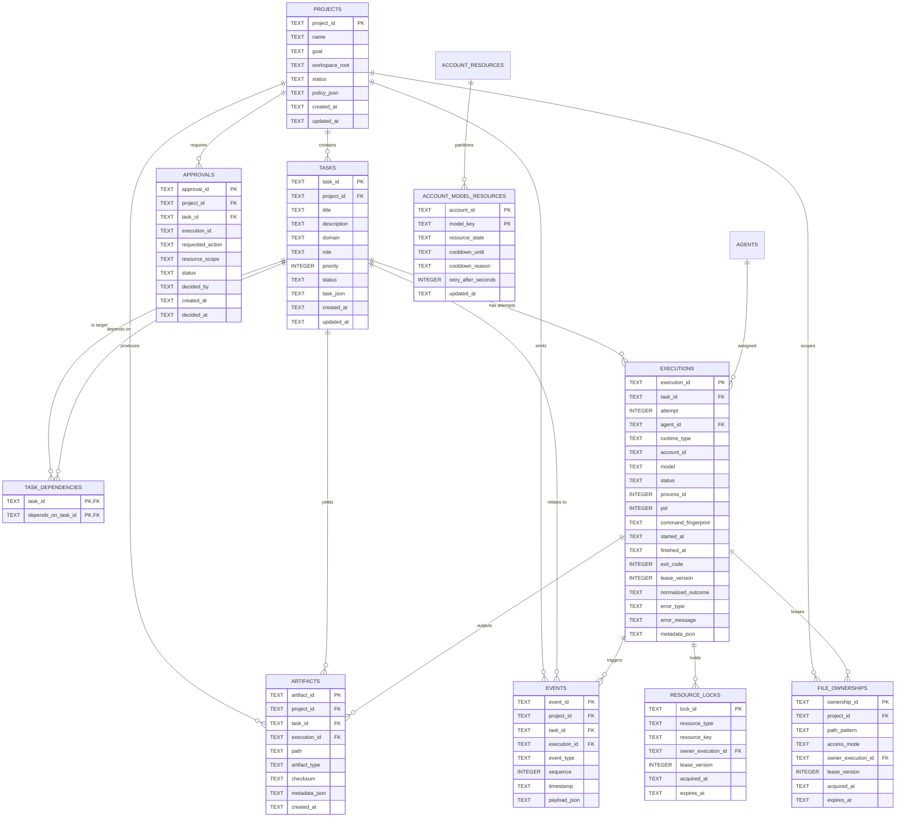
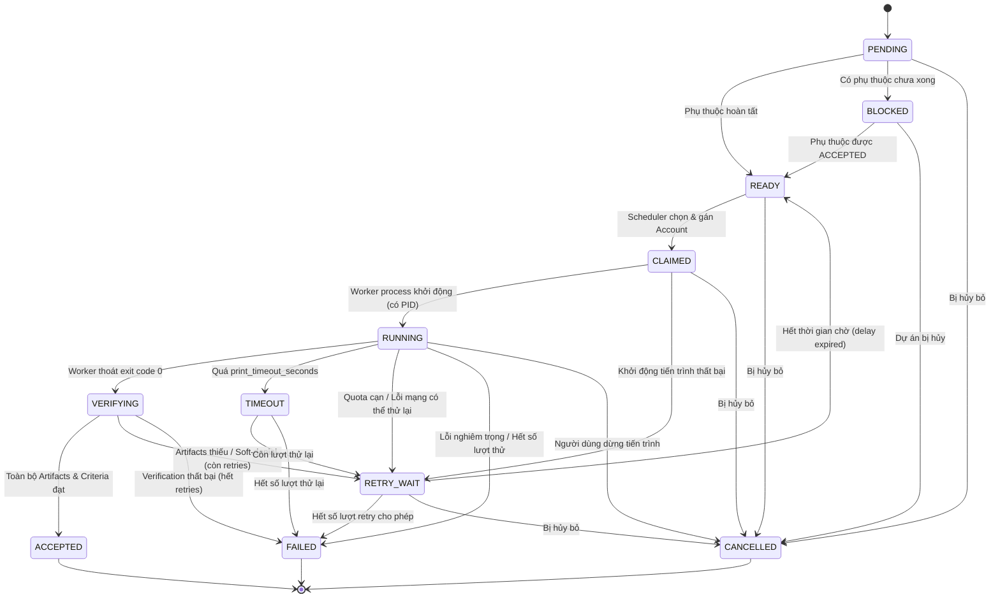
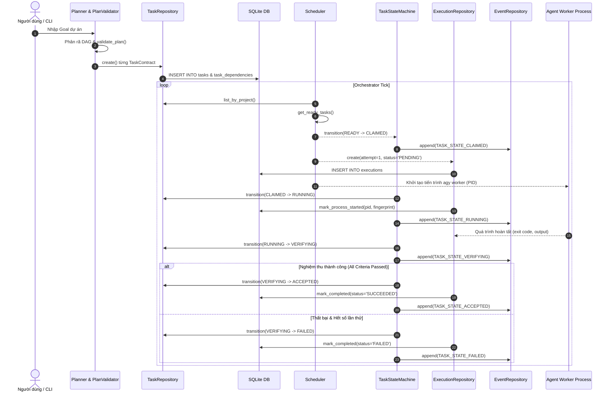

# GIÁO TRÌNH KIẾN TRÚC & PHÁT TRIỂN AGY-MAS
## CHUYÊN ĐỀ 02: STORAGE LAYER VÀ TASK ENGINE

> **Phiên bản tài liệu:** 1.1.0  
> **Phạm vi mã nguồn:** [`src/agy_mas/storage/`](file:///C:/Users/TOAN%20PHUC/Desktop/project/multi-agy-tool/src/agy_mas/storage/) & [`src/agy_mas/planning/`](file:///C:/Users/TOAN%20PHUC/Desktop/project/multi-agy-tool/src/agy_mas/planning/), [`src/agy_mas/core/state_machine.py`](file:///C:/Users/TOAN%20PHUC/Desktop/project/multi-agy-tool/src/agy_mas/core/state_machine.py)  
> **Mục tiêu chuyên đề:** Đào tạo chuyên sâu về kiến trúc lưu trữ bền vững (Persistence Core) trên nền SQLite và động cơ điều phối tác vụ (Task Engine) với đồ thị DAG, máy trạng thái 12 bước, cùng bộ thẩm định chống xung đột ghi song song trong hệ thống Multi-Agent System (AGY-MAS).

---

## MỤC LỤC TỔNG QUAN

1. [Tổng Quan Kiến Trúc & Triết Lý Thiết Kế](#1-tổng-quan-kiến-trúc--triết-lý-thiết-kế)
   - 1.1. Bối cảnh bài toán và vị trí của Storage & Task Engine
   - 1.2. Các thách thức kỹ thuật trên môi trường Windows
   - 1.3. Các nguyên lý cốt lõi: Single Source of Truth, Idempotency, Determinism
2. [Chương 1: Tầng Lưu Trữ Bền Vững (Storage Layer - Phase 1)](#2-chương-1-tầng-lưu-trữ-bền-vững-storage-layer---phase-1)
   - 2.1. Quản lý Kết nối & Transaction Context: [`Database`](file:///C:/Users/TOAN%20PHUC/Desktop/project/multi-agy-tool/src/agy_mas/storage/database.py#L10)
   - 2.2. Điều phối Migration Tự động & Idempotent: [`MigrationRunner`](file:///C:/Users/TOAN%20PHUC/Desktop/project/multi-agy-tool/src/agy_mas/storage/migrations/runner.py#L8)
   - 2.3. Lược Đồ Cơ Sở Dữ Liệu & Entity Relationship Diagram (ERD)
   - 2.4. Phân Tích 10 Bảng Dữ Liệu Chi Tiết
   - 2.5. Hệ Thống 7 Repositories Chuyên Biệt
3. [Chương 2: Động Cơ Tác Vụ & Lập Kế Hoạch (Task Engine - Phase 2)](#3-chương-2-động-cơ-tác-vụ--lập-kế-hoạch-task-engine---phase-2)
   - 3.1. Hợp Đồng Tác Vụ Cứng Cáp: [`TaskContract`](file:///C:/Users/TOAN%20PHUC/Desktop/project/multi-agy-tool/src/agy_mas/planning/plan_schema.py#L55)
   - 3.2. Cỗ Máy Trạng Thái 12 Bước: [`TaskStateMachine`](file:///C:/Users/TOAN%20PHUC/Desktop/project/multi-agy-tool/src/agy_mas/core/state_machine.py#L28)
   - 3.3. Đồ Thị Ràng Buộc DAG & Thuật Toán Kahn: [`DependencyGraph`](file:///C:/Users/TOAN%20PHUC/Desktop/project/multi-agy-tool/src/agy_mas/planning/dependency_graph.py#L11)
   - 3.4. Bộ Thẩm Định Kế Hoạch 5 Tầng: [`PlanValidator`](file:///C:/Users/TOAN%20PHUC/Desktop/project/multi-agy-tool/src/agy_mas/planning/plan_validator.py#L16)
   - 3.5. Trình Phân Rã Kế Hoạch Tự Động: [`Planner`](file:///C:/Users/TOAN%20PHUC/Desktop/project/multi-agy-tool/src/agy_mas/planning/planner.py#L50)
4. [Chương 3: Giao Thoa Giữa Storage Layer & Task Engine](#4-chương-3-giao-thoa-giữa-storage-layer--task-engine)
   - 4.1. Cơ chế phối hợp với [`Scheduler`](file:///C:/Users/TOAN%20PHUC/Desktop/project/multi-agy-tool/src/agy_mas/core/scheduler.py#L20)
   - 4.2. Dòng chảy dữ liệu từ Task Creation đến Accepted / Failed
   - 4.3. Bất biến trong ghi nhận Lịch sử Thực thi (Immutable Executions)
5. [Chương 4: Các Ca Biên (Edge Cases) & Bẫy Kỹ Thuật Trên Windows](#5-chương-4-các-ca-biên-edge-cases--bẫy-kỹ-thuật-trên-windows)
   - 5.1. File Locking & SQLite Busy Timeout
   - 5.2. Atomic Next Attempt Calculation & Race Condition
   - 5.3. Tránh xung đột ghi đè song song qua Glob Pattern & Tiền tố Thư mục
   - 5.4. Lỗi "Soft Denial" và Tiêu chí Nghiệm thu Không phụ thuộc Exit Code
6. [Chương 5: Thực Hành & Bài Tập Chuyên Sâu (Hands-On Lab)](#6-chương-5-thực-hành--bài-tập-chuyên-sâu-hands-on-lab)
   - Lab 1: Khởi tạo Storage, nạp Schema, thiết lập DAG Tasks đa tầng
   - Lab 2: Thực thi vòng đời State Machine với Monotonic Event Logging
   - Lab 3: Thẩm định kế hoạch và tự động phát hiện Write Collisions
   - Bài tập tự luyện (Bài toán điều phối song song Microservices)
7. [Tổng Kết & Bảng Tra Cứu Nhanh (Cheat Sheet)](#7-tổng-kết--bảng-tra-cứu-nhanh-cheat-sheet)

---

## 1. TỔNG QUAN KIẾN TRÚC & TRIẾT LÝ THIẾT KẾ

### 1.1. Bối Cảnh Bài Toán và Vị Trí Của Storage & Task Engine

Hệ thống **AGY-MAS** (*Antigravity Multi-Agent System*) được xây dựng nhằm mục tiêu biến các mô hình trí tuệ nhân tạo (Google Antigravity CLI, Gemini models, Claude models) từ các công cụ lập trình đơn lẻ thành một **hệ thống đa tác tử tự động hóa hoàn toàn**.

Trong kiến trúc Modular Monolith của AGY-MAS, hai thành phần nền tảng đầu tiên (Phase 1 & Phase 2) chịu trách nhiệm duy trì tính toàn vẹn của toàn bộ hệ thống:

```
+-----------------------------------------------------------------------------------+
|                                  CLI & TUI Layer                                  |
|                            (main.py / agy_controller.py)                          |
+-----------------------------------------------------------------------------------+
                                         |
                                         v
+-----------------------------------------------------------------------------------+
|                        Orchestrator & Central Scheduler                           |
|                    (core/orchestrator.py, core/scheduler.py)                      |
+-----------------------------------------------------------------------------------+
           |                                                      |
           v                                                      v
+---------------------------------------+      +------------------------------------+
|         PHASE 2: TASK ENGINE          |      |      PHASE 1: STORAGE LAYER        |
|  - TaskContract (plan_schema.py)      |      |  - Database (database.py)          |
|  - TaskStateMachine (state_machine.py)| <==> |  - MigrationRunner (runner.py)     |
|  - DependencyGraph (dependency_graph) |      |  - 7 Repositories (repositories/*) |
|  - PlanValidator (plan_validator.py)  |      |  - WAL SQLite & Monotonic Events   |
|  - Planner (planner.py)               |      |                                    |
+---------------------------------------+      +------------------------------------+
           |                                                      |
           +--------------------------+---------------------------+
                                      v
+-----------------------------------------------------------------------------------+
|                   Execution, Workspace & Verification Subsystems                  |
|          (agents/process_manager, workspace/manager, verification/verifier)       |
+-----------------------------------------------------------------------------------+
```

- **Storage Layer (Phase 1)**: Cung cấp "trí nhớ bền vững" (Persistent Memory) cho toàn bộ MAS. Toàn bộ tiến trình, lịch sử thử nghiệm, phân bổ tài nguyên, sự kiện thời gian thực và artifacts đều được lưu trữ tập trung, cho phép hệ thống hồi phục an toàn (*Crash Recovery*) ngay cả khi máy trạm hoặc tiến trình bị tắt đột ngột.
- **Task Engine (Phase 2)**: Cung cấp "bộ não điều hành và phân xử logic" (Execution Core). Task Engine biến một mục tiêu lớn của con người thành một Đồ thị có hướng không chu trình (**DAG - Directed Acyclic Graph**), áp đặt máy trạng thái 12 bước nghiêm ngặt, và thẩm định độc lập quyền hạn đọc/ghi tệp nhằm bảo đảm nhiều tác tử có thể làm việc song song trên cùng một workspace mà **không gây xung đột ghi đè** (*zero write collision*).

---

### 1.2. Các Thách Thức Kỹ Thuật Trên Môi Trường Windows

Môi trường hệ điều hành Windows đặt ra những thử thách nghiêm trọng đối với các hệ thống song song đa tiến trình:
1. **Khóa Tệp Độc Quyền (Mandatory File Locking / `WinError 32`, `WinError 33`)**:
   Trên Windows, khi một tiến trình mở một tệp để đọc/ghi mà không chia sẻ cờ `FILE_SHARE_READ | FILE_SHARE_WRITE`, mọi tiến trình khác cố gắng chạm vào tệp đó sẽ bị hệ điều hành ném lỗi ngay lập tức. Nếu Storage Layer hoặc Task Engine không có cơ chế timeout và xử lý bất đối xứng, SQLite sẽ rơi vào tình trạng `database is locked`.
2. **Tiến Trình Mồ Côi (Orphan Processes)**:
   Khi một agent CLI bị ngắt quãng hoặc crash, tiến trình con có thể vẫn tiếp tục chạy ngầm và giữ lock các file mã nguồn.
3. **Cạn Kiệt Hạn Ngạch Đột Ngột (Quota Exhaustion & Soft Denial)**:
   Các tài khoản AI có thể chạm ngưỡng Rate Limit bất kỳ lúc nào. Nếu Task Engine không quản lý lịch sử thực thi bất biến (*Immutable Execution Attempts*), hệ thống sẽ không thể chuyển giao tác vụ (*failover*) sang tài khoản khác một cách minh bạch.

---

### 1.3. Các Nguyên Lý Cốt Lõi

1. **Single Source of Truth (Nguồn Chân Lý Duy Nhất)**: Mọi trạng thái của tác vụ, quyền sở hữu file, hạn ngạch tài khoản chỉ được phép xác định thông qua SQLite Database. Bộ nhớ RAM của các đối tượng Python chỉ đóng vai trò bộ đệm tạm thời.
2. **Idempotency (Tính Bất Biến Lặp)**: Mọi tác vụ migration, cập nhật trạng thái hay thẩm định đồ thị phụ thuộc đều phải có khả năng chạy lại nhiều lần mà không làm thay đổi trạng thái đúng cuối cùng.
3. **Deterministic DAG Scheduling (Lập Lịch Tất Định)**: Thứ tự sẵn sàng của tác vụ được suy diễn hoàn toàn toán học dựa trên giải thuật sắp xếp topo (Topological Sort), không phụ thuộc vào độ trễ ngẫu nhiên của các luồng xử lý (threads).

---

## 2. CHƯƠNG 1: TẦNG LƯU TRỮ BỀN VỮNG (STORAGE LAYER - PHASE 1)

### 2.1. Quản Lý Kết Nối & Transaction Context: `Database`

Toàn bộ thao tác cơ sở dữ liệu được đóng gói bên trong lớp [`Database`](file:///C:/Users/TOAN%20PHUC/Desktop/project/multi-agy-tool/src/agy_mas/storage/database.py#L10) tại tệp [`src/agy_mas/storage/database.py`](file:///C:/Users/TOAN%20PHUC/Desktop/project/multi-agy-tool/src/agy_mas/storage/database.py).

#### Cấu hình Pragmas gia cố (Hardened Pragmas)
Để đảm bảo SQLite chịu tải song song trên Windows giữa nhiều thread/worker, kết nối được khởi tạo với 3 pragma tối quan trọng:

```python
# Trích xuất từ src/agy_mas/storage/database.py
def _create_connection(self) -> sqlite3.Connection:
    conn = sqlite3.connect(
        self.db_path,
        timeout=self.busy_timeout_ms / 1000.0,
        check_same_thread=False
    )
    conn.row_factory = sqlite3.Row
    conn.execute("PRAGMA foreign_keys = ON;")
    conn.execute(f"PRAGMA busy_timeout = {self.busy_timeout_ms};")
    if self.wal_mode:
        conn.execute("PRAGMA journal_mode = WAL;")
    return conn
```

- **`PRAGMA foreign_keys = ON;`**: Mặc định trong SQLite, ràng buộc khóa ngoại (Foreign Keys) bị tắt vì lý do tương thích ngược. Bật cờ này bắt buộc đảm bảo tính toàn vẹn quan hệ giữa Task, Execution, Event và Project.
- **`PRAGMA busy_timeout = 5000;`**: Thiết lập thời gian chờ 5.000ms (5 giây). Khi một tiến trình đang giữ Write Lock, các kết nối khác đọc/ghi sẽ kiên nhẫn thử lại trong 5 giây trước khi quăng lỗi `sqlite3.OperationalError: database is locked`.
- **`PRAGMA journal_mode = WAL;`** (*Write-Ahead Logging*): WAL cho phép **nhiều tác tử đọc đồng thời với một tác tử ghi** mà không gây block lẫn nhau. Trên Windows, chế độ WAL phân tách file dữ liệu chính `.db` với file log `.db-wal` và file chỉ mục `.db-shm`.

#### Thread-Local Connection Pattern
Để tránh xung đột trạng thái con trỏ giữa các thread trong Python mà không phải tốn chi phí mở kết nối liên tục:

```python
self._local = threading.local()

@contextmanager
def connect(self) -> Generator[sqlite3.Connection, None, None]:
    if not hasattr(self._local, "conn") or self._local.conn is None:
        self._local.conn = self._create_connection()
    yield self._local.conn
```

Mỗi thread sở hữu một kết nối `sqlite3.Connection` riêng biệt được lưu trữ trong `_local`.

#### Transaction Context Manager
Phương thức [`transaction()`](file:///C:/Users/TOAN%20PHUC/Desktop/project/multi-agy-tool/src/agy_mas/storage/database.py#L48) quản lý ngữ cảnh giao dịch nguyên khối (*atomic transaction*):
- Tự động gọi `conn.commit()` khi khối lệnh `with` kết thúc thành công.
- Tự động gọi `conn.rollback()` và ném lại exception khi xảy ra bất kỳ lỗi nào.

---

### 2.2. Điều Phối Migration Tự Động & Idempotent: `MigrationRunner`

Lớp [`MigrationRunner`](file:///C:/Users/TOAN%20PHUC/Desktop/project/multi-agy-tool/src/agy_mas/storage/migrations/runner.py#L8) tại [`src/agy_mas/storage/migrations/runner.py`](file:///C:/Users/TOAN%20PHUC/Desktop/project/multi-agy-tool/src/agy_mas/storage/migrations/runner.py) đảm bảo cơ sở dữ liệu tự động cập nhật cấu trúc schema mới nhất một cách an toàn và có thể chạy lại bất cứ lúc nào (Idempotent).

```
                                  [run_all()]
                                       |
                   +-------------------+-------------------+
                   | Kiểm tra bảng schema_migrations      |
                   +-------------------+-------------------+
                                       |
                   +-------------------+-------------------+
                   | Version 1 đã có?                      |
                   +-------------------+-------------------+
                      / NO                               \ YES
                     v                                    v
     [_apply_v1_0_baseline]                       (Bỏ qua Baseline)
    Tạo 10 bảng cốt lõi v1.0                              |
    INSERT INTO schema_migrations (v1)                    |
                     |                                    |
                     +-----------------+------------------+
                                       v
                   +-------------------+-------------------+
                   | Version 2 đã có?                      |
                   +-------------------+-------------------+
                      / NO                               \ YES
                     v                                    v
     [_apply_v1_1_additions]                      (Bỏ qua v1.1)
    - Tạo account_model_resources                         |
    - Kiểm tra PRAGMA table_info(executions)              |
    - ALTER TABLE executions ADD COLUMN ...               |
    INSERT INTO schema_migrations (v2)                    |
                     |                                    |
                     +-----------------+------------------+
                                       v
                              [Trả về applied list]
```

#### Chiến lược mở rộng schema an toàn (Schema Evolution Safety)
Trong phiên bản kiến trúc v1.1, bảng `executions` cần bổ sung thêm các cột metadata như `runtime_name`, `pid`, `normalized_outcome`, v.v. SQLite không hỗ trợ cú pháp `ALTER TABLE ... ADD COLUMN IF NOT EXISTS`. Do đó, `MigrationRunner` truy vấn trước danh sách cột hiện có thông qua `PRAGMA table_info`:

```python
# Trích xuất từ src/agy_mas/storage/migrations/runner.py
columns_info = conn.execute("PRAGMA table_info(executions);").fetchall()
existing_cols: Set[str] = {row["name"] for row in columns_info}

cols_to_add = [
    ("runtime_name", "TEXT"),
    ("runtime_version", "TEXT"),
    ("pid", "INTEGER"),
    ("process_creation_time", "TEXT"),
    ("agent_print_timeout_seconds", "INTEGER"),
    ("termination_reason", "TEXT"),
    ("normalized_outcome", "TEXT"),
    ("parser_version", "TEXT"),
]

for col_name, col_type in cols_to_add:
    if col_name not in existing_cols:
        conn.execute(f"ALTER TABLE executions ADD COLUMN {col_name} {col_type};")
```
Kỹ thuật này triệt tiêu hoàn toàn lỗi crash khi migration được chạy lặp lại trên một cơ sở dữ liệu đã tồn tại.

---

### 2.3. Lược Đồ Cơ Sở Dữ Liệu & Entity Relationship Diagram (ERD)

Sơ đồ ERD chuẩn của AGY-MAS thể hiện mối liên kết giữa các thực thể cốt lõi:



---

### 2.4. Phân Tích 10 Bảng Dữ Liệu Chi Tiết

| STT | Tên Bảng | Khóa Chính (PK) | Mục Đích Nghiệp Vụ & Ràng Buộc Đặc Biệt |
| :--- | :--- | :--- | :--- |
| **1** | `schema_migrations` | `version` | Lưu trữ lịch sử nâng cấp schema, đảm bảo tính idempotent. |
| **2** | `projects` | `project_id` | Đại diện cho một phiên điều phối cấp cao, lưu `workspace_root` và chính sách hệ thống. |
| **3** | `tasks` | `task_id` | Đơn vị công việc tối thiểu trong DAG. Lưu trữ toàn bộ hợp đồng nghiệp vụ trong `task_json`. Có chỉ mục `idx_tasks_project_status`. |
| **4** | `task_dependencies` | `(task_id, depends_on_task_id)` | Ràng buộc quan hệ DAG. Có ràng buộc kiểm tra `CHECK (task_id <> depends_on_task_id)` ngăn chặn task tự phụ thuộc chính nó. |
| **5** | `agents` | `agent_id` | Khai báo runtime khả dụng (`agy`, `mock`, `api`) và năng lực của tác tử. |
| **6** | `executions` | `execution_id` | Bản ghi **bất biến** (Immutable) cho từng lần chạy của một task. Ràng buộc `UNIQUE (task_id, attempt)` đảm bảo số thứ tự attempt luôn tăng đơn điệu. Lưu PID và chữ ký dòng lệnh `command_fingerprint`. |
| **7** | `artifacts` | `artifact_id` | Lưu trữ siêu dữ liệu của các file sản phẩm được tạo ra, gồm đường dẫn tương đối và checksum SHA256 để xác minh tính toàn vẹn. |
| **8** | `events` | `event_id` | Nhật ký sự kiện chuẩn Event-Sourcing. Ràng buộc `UNIQUE (project_id, sequence)` bảo đảm số thứ tự `sequence` là đơn điệu tăng dần không ngắt quãng trong từng dự án. Có chỉ mục `idx_events_project_sequence`. |
| **9** | `resource_locks` & `file_ownerships` | `lock_id` / `ownership_id` | Quản lý khóa tài nguyên và quyền ghi tệp độc quyền (`lease_version`). Tự động xử lý hết hạn qua cột `expires_at` và chỉ mục `idx_locks_expiry`. |
| **10** | `account_model_resources` | `(account_id, model_key)` | Bổ sung trong v1.1. Theo dõi tình trạng hạn ngạch granular theo từng cặp Tài khoản - Model, lưu thời điểm hết hạn cooldown và nguyên nhân cạn quota. |

---

### 2.5. Hệ Thống 7 Repositories Chuyên Biệt

Để cô lập tầng truy cập dữ liệu (Data Access Layer) khỏi logic nghiệp vụ, AGY-MAS thiết kế 7 repositories tại thư mục [`src/agy_mas/storage/repositories/`](file:///C:/Users/TOAN%20PHUC/Desktop/project/multi-agy-tool/src/agy_mas/storage/repositories/):

#### 1. [`ProjectRepository`](file:///C:/Users/TOAN%20PHUC/Desktop/project/multi-agy-tool/src/agy_mas/storage/repositories/project_repo.py#L9)
Quản lý vòng đời dự án:
- `create(project_id, name, goal, workspace_root, status, policy)`: Tạo dự án mới, tự động serialize policy sang JSON.
- `get(project_id)`: Truy xuất thông tin dự án kèm policy được deserialize.
- `update_status(project_id, status)`: Cập nhật trạng thái dự án (`CREATED`, `RUNNING`, `COMPLETED`, `FAILED`).

#### 2. [`TaskRepository`](file:///C:/Users/TOAN%20PHUC/Desktop/project/multi-agy-tool/src/agy_mas/storage/repositories/task_repo.py#L9)
Quản lý tác vụ và đồ thị phụ thuộc:
- `create(...)`: Thêm task mới và nạp danh sách `depends_on` vào bảng phụ thuộc trong cùng 1 transaction nguyên tử.
- `get(task_id)`: Trả về chi tiết task, nạp ngược JSON `task_spec` và danh sách phụ thuộc từ `task_dependencies`.
- `list_by_project(project_id, status)`: Lấy danh sách task sắp xếp theo `priority DESC, created_at ASC`.
- `add_dependency(task_id, depends_on_task_id)`: Bổ sung phụ thuộc, cấm self-dependency (quăng `ValueError`).
- `get_dependency_map(project_id)`: Truy vấn toàn bộ DAG của dự án thành từ điển `Dict[str, List[str]]`.

#### 3. [`ExecutionRepository`](file:///C:/Users/TOAN%20PHUC/Desktop/project/multi-agy-tool/src/agy_mas/storage/repositories/execution_repo.py#L9)
Quản lý các lượt thực thi (attempts) bất biến:
- `create(...)`: Tự động tính toán số lượt thử kế tiếp bằng truy vấn nguyên tử `SELECT COALESCE(MAX(attempt), 0) + 1 FROM executions WHERE task_id = ?;`.
- `mark_process_started(execution_id, pid, command_fingerprint)`: Chuyển trạng thái sang `RUNNING`, lưu PID và thời điểm tạo tiến trình của Windows.
- `mark_completed(execution_id, status, exit_code, normalized_outcome, error_type, ...)`: Ghi nhận kết quả thực thi cuối cùng và lý do kết thúc.

#### 4. [`EventRepository`](file:///C:/Users/TOAN%20PHUC/Desktop/project/multi-agy-tool/src/agy_mas/storage/repositories/event_repo.py#L10)
Quản lý luồng sự kiện đơn điệu (Monotonic Event Stream):
- `append(project_id, event_type, payload, task_id, execution_id)`: Tính toán số `sequence = MAX(sequence) + 1` cho dự án và chèn bản ghi mới.
- `list_by_project(project_id, after_sequence, limit)`: Truy vấn sự kiện phục vụ Event Sourcing, hiển thị UI thời gian thực hoặc rà soát kiểm toán.

#### 5. [`ArtifactRepository`](file:///C:/Users/TOAN%20PHUC/Desktop/project/multi-agy-tool/src/agy_mas/storage/repositories/artifact_repo.py#L10)
Quản lý tài liệu và sản phẩm đầu ra:
- `register(project_id, task_id, execution_id, path, artifact_type, checksum, metadata)`: Đăng ký một artifact hoàn tất vào DB.
- `list_by_task(task_id)` / `list_by_execution(execution_id)`: Liệt kê các deliverables theo task hoặc lần thực thi.

#### 6. [`ResourceRepository`](file:///C:/Users/TOAN%20PHUC/Desktop/project/multi-agy-tool/src/agy_mas/storage/repositories/resource_repo.py#L8)
Quản lý tranh chấp khóa và hạn ngạch:
- `acquire_lock(...)`: Cấp phát khóa tài nguyên. Nếu khóa cũ đã quá hạn `expires_at < now`, tự động thu hồi và cấp quyền cho yêu cầu mới.
- `release_lock(...)`: Trả khóa tài nguyên.
- `set_account_model_cooldown(...)`: Đưa một cặp `(account_id, model_key)` vào trạng thái `COOLDOWN` kèm thời điểm mở lại và lý do.
- `is_in_cooldown(account_id, model_key)`: Kiểm tra tính sẵn sàng của tài khoản; tự động dọn dẹp (lazy reset) trạng thái cooldown nếu đã hết hạn.

#### 7. [`ApprovalRepository`](file:///C:/Users/TOAN%20PHUC/Desktop/project/multi-agy-tool/src/agy_mas/storage/repositories/approval_repo.py#L10)
Quản lý phê duyệt của người dùng (Human-In-The-Loop):
- `request_approval(...)`: Tạo yêu cầu phê chuẩn khi agent muốn thực hiện hành vi nhạy cảm (ghi đè file cấu hình hệ thống, vượt ngoài scope cho phép).
- `decide(approval_id, decision, decided_by, decision_payload)`: Chấp thuận hoặc từ chối hành động.

---

## 3. CHƯƠNG 2: ĐỘNG CƠ TÁC VỤ & LẬP KẾ HOẠCH (TASK ENGINE - PHASE 2)

### 3.1. Hợp Đồng Tác Vụ Cứng Cáp: `TaskContract`

Tệp [`src/agy_mas/planning/plan_schema.py`](file:///C:/Users/TOAN%20PHUC/Desktop/project/multi-agy-tool/src/agy_mas/planning/plan_schema.py) định nghĩa cấu trúc dữ liệu cốt lõi của một tác vụ trong hệ thống:

```python
# Cấu trúc khái niệm của TaskContract
@dataclass
class TaskContract:
    task_id: str
    project_id: str
    title: str
    description: str
    domain: str = "software"
    role: str = "developer"
    priority: int = 50
    inputs: InputScope = field(default_factory=InputScope)
    outputs: OutputScope = field(default_factory=OutputScope)
    acceptance_criteria: List[AcceptanceCriterion] = field(default_factory=list)
    permission_profile: PermissionProfile = field(default_factory=PermissionProfile)
    max_retries: int = 2
    retry_delay_seconds: int = 10
    timeout_seconds: int = 900
    depends_on: List[str] = field(default_factory=list)
```

#### Các thành phần chi tiết trong Hợp Đồng

1. **[`InputScope`](file:///C:/Users/TOAN%20PHUC/Desktop/project/multi-agy-tool/src/agy_mas/planning/plan_schema.py#L8)**:
   - `paths`: Danh sách file/thư mục đầu vào mà tác vụ cần đọc để hiểu ngữ cảnh.
   - `parameters`: Các tham số tinh chỉnh (ví dụ: `model: "gemini-3.8-flash"`, `effort: "high"`).
   - `context_keys`: Các biến khóa ngữ cảnh được truyền từ các tác vụ trước.

2. **[`OutputScope`](file:///C:/Users/TOAN%20PHUC/Desktop/project/multi-agy-tool/src/agy_mas/planning/plan_schema.py#L24) & [`ExpectedArtifact`](file:///C:/Users/TOAN%20PHUC/Desktop/project/multi-agy-tool/src/agy_mas/planning/plan_schema.py#L16)**:
   - Tác vụ phải khai báo tường minh danh sách sản phẩm bàn giao (`expected_artifacts`).
   - Mỗi artifact bao gồm: `path` (đường dẫn tương đối), `artifact_type` (`FILE`, `TEST_REPORT`, `LOG`, `CODE`), `min_size_bytes` (kích thước tối thiểu, mặc định 1 byte), và cờ `required` (bắt buộc hay tùy chọn).

3. **[`AcceptanceCriterion`](file:///C:/Users/TOAN%20PHUC/Desktop/project/multi-agy-tool/src/agy_mas/planning/plan_schema.py#L30)**:
   - Các tiêu chuẩn nghiệm thu độc lập được xác minh bởi bộ `Verifier`:
     - `EXIT_CODE_ZERO`: Tiến trình worker phải kết thúc với mã thoát 0.
     - `ARTIFACT_EXISTS`: Mọi deliverables đã đăng ký phải tồn tại trên đĩa và lớn hơn `min_size_bytes`.
     - `NO_SOFT_DENIAL`: Không được chứa thông báo lỗi quyền từ chối ngầm của AGY CLI trong stdout/stderr.
     - `TEST_PASSED`: Các bài kiểm thử unit tests tự động phải vượt qua hoàn toàn.

4. **[`PermissionProfile`](file:///C:/Users/TOAN%20PHUC/Desktop/project/multi-agy-tool/src/agy_mas/planning/plan_schema.py#L37)**:
   - Kiểm soát chặt chẽ quyền truy cập đường dẫn: `read_paths`, `write_paths`.
   - Hàm [`allows_write(target_path)`](file:///C:/Users/TOAN%20PHUC/Desktop/project/multi-agy-tool/src/agy_mas/planning/plan_schema.py#L43) kiểm tra quyền ghi đè:

```python
# Trích xuất từ src/agy_mas/planning/plan_schema.py
def allows_write(self, target_path: str) -> bool:
    if self.dangerously_skip_permissions:
        return True
    norm = target_path.replace("\\", "/").lstrip("/")
    for wp in self.write_paths:
        wp_norm = wp.replace("\\", "/").lstrip("/")
        if fnmatch.fnmatch(norm, wp_norm) or norm.startswith(wp_norm.rstrip("*").rstrip("/")):
            return True
    return False
```

Thuật toán chuẩn hóa dấu phân cách trên Windows (`\` sang `/`) và hỗ trợ cả khớp mẫu glob (`fnmatch`) lẫn tiền tố thư mục (prefix matching).

---

### 3.2. Cỗ Máy Trạng Thái 12 Bước: `TaskStateMachine`

Máy trạng thái [`TaskStateMachine`](file:///C:/Users/TOAN%20PHUC/Desktop/project/multi-agy-tool/src/agy_mas/core/state_machine.py#L28) kiểm soát vòng đời của tác vụ qua 12 trạng thái khắt khe tại [`src/agy_mas/core/state_machine.py`](file:///C:/Users/TOAN%20PHUC/Desktop/project/multi-agy-tool/src/agy_mas/core/state_machine.py).

#### Sơ Đồ Chuyển Đổi Trạng Thái (State Transition Diagram)



#### Ma Trận Chuyển Đổi Hợp Lệ (`VALID_TRANSITIONS`)

```python
# Trích xuất từ src/agy_mas/core/state_machine.py
VALID_TRANSITIONS: Dict[TaskState, Set[TaskState]] = {
    TaskState.PENDING:    {TaskState.READY, TaskState.BLOCKED, TaskState.CANCELLED},
    TaskState.BLOCKED:    {TaskState.READY, TaskState.CANCELLED},
    TaskState.READY:      {TaskState.CLAIMED, TaskState.CANCELLED},
    TaskState.CLAIMED:    {TaskState.RUNNING, TaskState.RETRY_WAIT, TaskState.CANCELLED},
    TaskState.RUNNING:    {TaskState.VERIFYING, TaskState.RETRY_WAIT, TaskState.FAILED, TaskState.TIMEOUT, TaskState.CANCELLED},
    TaskState.VERIFYING:  {TaskState.ACCEPTED, TaskState.RETRY_WAIT, TaskState.FAILED},
    TaskState.RETRY_WAIT: {TaskState.READY, TaskState.FAILED, TaskState.CANCELLED},
    TaskState.TIMEOUT:    {TaskState.RETRY_WAIT, TaskState.FAILED},
    TaskState.ACCEPTED:   set(),  # Terminal state
    TaskState.FAILED:     set(),  # Terminal state
    TaskState.CANCELLED:  set(),  # Terminal state
}
```

- **Quy tắc bất biến**: Nếu một tác vụ cố gắng chuyển trạng thái trái luật (ví dụ: chuyển trực tiếp từ `PENDING` sang `ACCEPTED` mà không qua `RUNNING` và `VERIFYING`), phương thức `transition()` sẽ ném ngoại lệ [`InvalidStateTransitionError`](file:///C:/Users/TOAN%20PHUC/Desktop/project/multi-agy-tool/src/agy_mas/core/state_machine.py#L23).
- **Tự động ghi nhận sự kiện (Event Hook)**: Mỗi lần chuyển trạng thái thành công, hệ thống tự động ghi một sự kiện tương ứng vào [`EventRepository`](file:///C:/Users/TOAN%20PHUC/Desktop/project/multi-agy-tool/src/agy_mas/storage/repositories/event_repo.py#L10) với định dạng `TASK_STATE_{target_state}` kèm payload lưu lại trạng thái trước, trạng thái sau, lý do và execution_id.

---

### 3.3. Đồ Thị Ràng Buộc DAG & Thuật Toán Kahn: `DependencyGraph`

Lớp [`DependencyGraph`](file:///C:/Users/TOAN%20PHUC/Desktop/project/multi-agy-tool/src/agy_mas/planning/dependency_graph.py#L11) tại [`src/agy_mas/planning/dependency_graph.py`](file:///C:/Users/TOAN%20PHUC/Desktop/project/multi-agy-tool/src/agy_mas/planning/dependency_graph.py) phụ trách quản trị đồ thị DAG:

#### Biểu diễn nội tại
- `adj: Dict[str, Set[str]]`: Danh sách kề xuôi. `adj[A]` chứa tập hợp các tác vụ *phụ thuộc vào A* (khi A xong thì các tác vụ này mới được kích hoạt).
- `rev_adj: Dict[str, Set[str]]`: Danh sách kề ngược. `rev_adj[B]` chứa tập hợp các tác vụ *mà B phải chờ* (tiền đề của B).

#### Thuật toán Kahn trong sắp xếp Topo & Phát hiện Chu trình
Thuật toán Kahn được sử dụng trong [`topological_sort()`](file:///C:/Users/TOAN%20PHUC/Desktop/project/multi-agy-tool/src/agy_mas/planning/dependency_graph.py#L42):

```python
# Trích xuất từ src/agy_mas/planning/dependency_graph.py
def topological_sort(self) -> List[str]:
    in_degree: Dict[str, int] = {node: len(self.rev_adj.get(node, set())) for node in self.adj}
    queue = [node for node, deg in in_degree.items() if deg == 0]
    sorted_nodes: List[str] = []

    while queue:
        node = queue.pop(0)
        sorted_nodes.append(node)
        for dependent in self.adj.get(node, set()):
            in_degree[dependent] -= 1
            if in_degree[dependent] == 0:
                queue.append(dependent)

    if len(sorted_nodes) != len(self.adj):
        unresolved = [node for node, deg in in_degree.items() if deg > 0]
        raise CycleDetectedError(f"Dependency cycle detected involving tasks: {unresolved}")

    return sorted_nodes
```

1. **Khởi tạo**: Đếm số bậc vào (`in_degree`) của từng đỉnh (số lượng task mà node đó phụ thuộc vào).
2. **Hàng đợi ban đầu**: Đưa tất cả các đỉnh có `in_degree == 0` (không phụ thuộc vào ai) vào hàng đợi `queue`.
3. **Lan truyền**: Rút từng đỉnh ra, thêm vào danh sách kết quả `sorted_nodes`, và giảm bậc vào của các đỉnh phụ thuộc nó đi 1. Nếu đỉnh con đạt bậc vào bằng 0, đẩy vào hàng đợi.
4. **Phát hiện chu trình**: Nếu độ dài của `sorted_nodes` nhỏ hơn tổng số đỉnh trong đồ thị, một chu trình vòng lặp kín đã xuất hiện. Hệ thống lập tức ném lỗi [`CycleDetectedError`](file:///C:/Users/TOAN%20PHUC/Desktop/project/multi-agy-tool/src/agy_mas/planning/dependency_graph.py#L6).

#### Tính Toán Tác Vụ Sẵn Sàng (`get_ready_tasks`)
Một tác vụ chỉ được coi là sẵn sàng (`READY`) khi và chỉ khi:
- Trạng thái hiện tại của nó là `PENDING`, `BLOCKED`, hoặc `READY`.
- **Toàn bộ** các tác vụ trong `rev_adj[task_id]` đều đã đạt trạng thái `ACCEPTED`:

```python
def get_ready_tasks(self, task_statuses: Dict[str, str]) -> List[str]:
    ready = []
    for task_id, status in task_statuses.items():
        if status in ("PENDING", "BLOCKED", "READY"):
            deps = self.rev_adj.get(task_id, set())
            if all(task_statuses.get(dep) == "ACCEPTED" for dep in deps):
                ready.append(task_id)
    return ready
```

---

### 3.4. Bộ Thẩm Định Kế Hoạch 5 Tầng: `PlanValidator`

Trước khi bất kỳ một tập hợp `TaskContract` nào được ghi vào cơ sở dữ liệu để thực thi, nó bắt buộc phải vượt qua bộ lọc 5 tầng nghiêm ngặt của [`PlanValidator`](file:///C:/Users/TOAN%20PHUC/Desktop/project/multi-agy-tool/src/agy_mas/planning/plan_validator.py#L16) tại [`src/agy_mas/planning/plan_validator.py`](file:///C:/Users/TOAN%20PHUC/Desktop/project/multi-agy-tool/src/agy_mas/planning/plan_validator.py):

```
                                  [validate_plan(contracts)]
                                              |
     +----------------------------------------+----------------------------------------+
     |                                                                                 |
     v                                                                                 v
[Tầng 1: Tính Toàn Vẹn]                                                   [Tầng 2: Phát Hiện Chu Trình]
- task_id không trùng lặp                                                  - Chạy Kahn topological sort
- depends_on phải tồn tại trong plan                                      - Ném CycleDetectedError nếu có vòng lặp
     |                                                                                 |
     +----------------------------------------+----------------------------------------+
                                              |
     +----------------------------------------+----------------------------------------+
     |                                                                                 |
     v                                                                                 v
[Tầng 3: Bảo Mật Đường Dẫn]                                               [Tầng 4: Tiêu Chí Nghiệm Thu]
- Cấm tuyệt đối Path Traversal:                                           - Nếu khai báo expected_artifacts
  không bắt đầu bằng "/",                                                   bắt buộc phải có ít nhất
  không chứa "..", không "/../"                                             1 acceptance_criteria
     |                                                                                 |
     +----------------------------------------+----------------------------------------+
                                              |
                                              v
                              [Tầng 5: Xung Đột Ghi Đè Song Song]
                              - So sánh mọi cặp (Task A, Task B)
                              - Nếu A và B ĐỘC LẬP (A không là tổ tiên của B và ngược lại)
                              - Kiểm tra write_paths có overlap không?
                              - Nếu có va chạm: NÉM LỖI XUNG ĐỘT GHI ĐÈ!
```

#### Thuật toán phát hiện Xung Đột Ghi Đè Song Song (Concurrent Write Scope Collisions)
Hai tác vụ chỉ được phép ghi vào cùng một đường dẫn (hoặc thư mục con) nếu **tác vụ này phụ thuộc tuần tự vào tác vụ kia** (nghĩa là một tác vụ là tổ tiên trong đồ thị của tác vụ kia). Nếu hai tác vụ độc lập (có thể được Scheduler bốc chạy song song trên 2 agent cùng lúc) cùng ghi vào một vùng tệp, hệ thống sẽ từ chối kế hoạch:

```python
# Trích xuất từ src/agy_mas/planning/plan_validator.py
ancestors_map: Dict[str, set] = {}
for c in contracts:
    ancestors_map[c.task_id] = cls._get_all_ancestors(c.task_id, graph)

for i in range(len(contracts)):
    for j in range(i + 1, len(contracts)):
        t1 = contracts[i]
        t2 = contracts[j]

        # Kiểm tra tính độc lập (không có quan hệ tổ tiên)
        is_dependent = (t1.task_id in ancestors_map[t2.task_id]) or (t2.task_id in ancestors_map[t1.task_id])
        if not is_dependent:
            overlap = cls._find_path_overlap(
                t1.permission_profile.write_paths,
                t2.permission_profile.write_paths
            )
            if overlap:
                errors.append(
                    f"Concurrent write conflict between independent tasks '{t1.task_id}' and '{t2.task_id}' on path(s): {overlap}"
                )
```

Hàm `_find_path_overlap` xử lý cả 3 tình huống va chạm:
1. Hai đường dẫn tuyệt đối bằng nhau (`norm1 == norm2`).
2. Khớp mẫu ký tự đại diện wildcard (`fnmatch.fnmatch(norm1, norm2)` hoặc ngược lại, ví dụ: `src/api/*` va chạm với `src/api/auth.py`).
3. Khớp tiền tố thư mục lồng nhau (`norm1.startswith(norm2 + "/")` hoặc ngược lại, ví dụ: `src/auth` va chạm với `src/auth/jwt/token.py`).

---

### 3.5. Trình Phân Rã Kế Hoạch Tự Động: `Planner`

Lớp [`Planner`](file:///C:/Users/TOAN%20PHUC/Desktop/project/multi-agy-tool/src/agy_mas/planning/planner.py#L50) tại [`src/agy_mas/planning/planner.py`](file:///C:/Users/TOAN%20PHUC/Desktop/project/multi-agy-tool/src/agy_mas/planning/planner.py) cung cấp khả năng tự động hóa lập kế hoạch từ Goal của người dùng:
1. **LLM Decomposition (`_decompose_with_llm`)**: Sử dụng Antigravity CLI ở chế độ headless để phân rã mục tiêu thành 2 đến 4 subtasks độc lập kèm write paths và expected artifacts.
2. **Heuristic Fallback (`_decompose_heuristic_fallback`)**: Nếu không có binary `agy` hoặc không có mạng, hệ thống tự động sinh cấu trúc chuẩn 3 tầng: `core_scaffold` -> `feature_implementation` -> `verification_and_tests`.
3. **Auto-Serialize Collisions (`_auto_serialize_collisions`)**: Nếu LLM lỡ sinh ra các tác vụ độc lập bị va chạm ghi đè, `Planner` không crash mà tự động bổ sung cạnh phụ thuộc `t2.depends_on.append(t1.task_id)`, chuyển quan hệ song song thành tuần tự an toàn!

---

## 4. CHƯƠNG 3: GIAO THOA GIỮA STORAGE LAYER & TASK ENGINE

Mối quan hệ cộng sinh giữa Storage Layer và Task Engine được biểu hiện rõ nét nhất qua hoạt động của **Central Scheduler** và **Orchestrator**.

### 4.1. Cơ Chế Phối Hợp Với `Scheduler`

Mỗi nhịp tick của hệ điều phối, [`Scheduler.schedule_next()`](file:///C:/Users/TOAN%20PHUC/Desktop/project/multi-agy-tool/src/agy_mas/core/scheduler.py#L35) thực hiện các bước sau:

```
[Orchestrator Tick]
       |
       v
1. Truy vấn danh sách Task từ TaskRepository
       |
       v
2. Dựng DependencyGraph từ quan hệ tasks & task_dependencies
       |
       v
3. Gọi graph.get_ready_tasks(task_statuses) để lọc các task có tất cả phụ thuộc là 'ACCEPTED'
       |
       v
4. Với từng Task sẵn sàng:
   + Kiểm tra slot trống: running_count < max_concurrency
   + Trích xuất model yêu cầu từ TaskContract
   + Tham vấn QuotaTracker / ResourceRepository:
     Kiểm tra tài khoản khả dụng nào KHÔNG nằm trong COOLDOWN đối với model này?
       |
       +---> [Có tài khoản phù hợp] ---> Trả về ScheduleDecision(task_id, account_id, model)
       |
       +---> [Tất cả tài khoản Cooldown] ---> Giữ task ở trạng thái READY, chờ nhịp sau
```

---

### 4.2. Dòng Chảy Dữ Liệu Từ Task Creation Đến Accepted / Failed



---

### 4.3. Bất Biến Trong Ghi Nhận Lịch Sử Thực Thi (Immutable Executions)

Một nguyên tắc thiết kế quan trọng trong Storage Layer của AGY-MAS là: **Bảng `tasks` lưu trữ trạng thái hiện thời, còn bảng `executions` lưu trữ toàn bộ lịch sử tiến hóa theo thời gian.**

Khi một tác vụ thất bại (ví dụ do cạn quota ở tài khoản A) và được thử lại trên tài khoản B:
- Trạng thái của task chuyển từ `RUNNING` -> `RETRY_WAIT` -> `READY` -> `CLAIMED` -> `RUNNING`.
- Bản ghi `executions` cho lần chạy đầu tiên (`attempt = 1`) được giữ nguyên vẹn với đầy đủ thông tin: PID, thời điểm bắt đầu, thời điểm kết thúc, mã lỗi `QUOTA_EXHAUSTED`, exit code.
- Một bản ghi `executions` mới toanh được tạo ra với `attempt = 2`, liên kết với `account_id` mới.

Tính bất biến này đem lại 3 lợi ích vượt trội:
1. **Kiểm toán chính xác (Auditability)**: Người quản trị luôn biết chính xác tác vụ đã tiêu tốn bao nhiêu tài nguyên và gặp lỗi gì ở từng lần chạy.
2. **Loại trừ Race Condition**: Không có hiện tượng cập nhật đè làm mất log của tiến trình trước.
3. **Phân tích lỗi AI**: Cho phép các thuật toán phục hồi so sánh output của các lần thử khác nhau để phát hiện vòng lặp lỗi lặp đi lặp lại.

---

## 5. CÁC CA BIÊN (EDGE CASES) & BẪY KỸ THUẬT TRÊN WINDOWS

Trong quá trình xây dựng hệ thống trên nền tảng Windows, bốn bẫy kỹ thuật kinh điển sau đây đã được giải quyết triệt để trong mã nguồn:

### 5.1. File Locking & SQLite Busy Timeout
- **Hiện tượng**: Khi nhiều thread cùng gọi lệnh `execute()` hoặc mở transaction, hệ điều hành Windows giữ lock độc quyền trên file database, gây lỗi `sqlite3.OperationalError: database is locked`.
- **Giải pháp trong AGY-MAS**:
  1. Kích hoạt chế độ `WAL` mode (`PRAGMA journal_mode = WAL;`) ngay khi mở kết nối.
  2. Đặt `busy_timeout = 5000ms`. SQLite engine sẽ tự động lùi bước (sleep & retry) trong 5 giây trước khi ném lỗi.
  3. Kết hợp context manager `@contextmanager transaction()` để mọi giao dịch đều hoàn tất hoặc rollback tức thì, giải phóng khóa nhanh nhất có thể.

### 5.2. Atomic Next Attempt Calculation & Race Condition
- **Hiện tượng**: Nếu 2 worker cùng cố gắng tạo lượt thực thi cho một task, cả hai có thể cùng đọc ra `attempt = 1` và gây lỗi vi phạm ràng buộc `UNIQUE (task_id, attempt)`.
- **Giải pháp trong AGY-MAS**:
  Thực hiện việc tính toán `attempt` và `INSERT` trong cùng **một transaction duy nhất**:
  ```sql
  SELECT COALESCE(MAX(attempt), 0) + 1 AS next_attempt FROM executions WHERE task_id = ?;
  ```
  Nhờ transaction lock của SQLite, việc tính toán và ghi nhận là tuyệt đối nguyên tử (*atomic*).

### 5.3. Tránh Xung Đột Ghi Đè Song Song Qua Glob Pattern & Tiền Tố Thư Mục
- **Hiện tượng**: Một agent được phân công viết `src/utils/math.py`, agent khác viết `src/utils/*`. Nếu chạy song song, cả hai sẽ sửa file trong cùng thư mục `src/utils/`, dẫn đến tình trạng Windows file locking hoặc code bị đè lẫn nhau.
- **Giải pháp trong AGY-MAS**:
  `PlanValidator` chuẩn hóa dấu gạch chéo về `/`, loại bỏ dấu gạch chéo đầu cuối, và so khớp cả hai chiều:
  - Nếu `norm1.startswith(norm2 + "/")` -> Báo lỗi xung đột thư mục lồng nhau.
  - Nếu `fnmatch(norm1, norm2)` hoặc `fnmatch(norm2, norm1)` -> Báo lỗi xung đột ký tự đại diện wildcard.

### 5.4. Lỗi "Soft Denial" Và Tiêu Chí Nghiệm Thu Không Phụ Thuộc Exit Code
- **Hiện tượng**: Antigravity CLI khi bị từ chối quyền (ví dụ: người dùng cấu hình chặn model hoặc hết quota) có thể in thông báo từ chối ra màn hình nhưng tiến trình vẫn kết thúc với exit code 0 (`SUCCESS`). Nếu chỉ kiểm tra `exit_code == 0`, hệ thống sẽ tưởng nhầm tác vụ đã thành công và chuyển sang `ACCEPTED`.
- **Giải pháp trong AGY-MAS**:
  Quy tắc kiến trúc ADR-014 quy định: Tiêu chí nghiệm thu [`AcceptanceCriterion`](file:///C:/Users/TOAN%20PHUC/Desktop/project/multi-agy-tool/src/agy_mas/planning/plan_schema.py#L30) bắt buộc phải phối hợp cả `EXIT_CODE_ZERO` lẫn `ARTIFACT_EXISTS` và `NO_SOFT_DENIAL`. Cho dù exit code bằng 0, nếu artifact đầu ra chưa xuất hiện trên đĩa hoặc có thông báo lỗi soft denial trong log, tác vụ vẫn bị từ chối nghiệm thu và đưa về `RETRY_WAIT`.

---

## 6. CHƯƠNG 5: THỰC HÀNH & BÀI TẬP CHUYÊN SÂU (HANDS-ON LAB)

### Lab 1: Khởi Tạo Storage, Nạp Schema, Thiết Lập DAG Tasks Đa Tầng

Mục tiêu: Viết một kịch bản Python khởi tạo cơ sở dữ liệu in-memory, chạy migration và tạo một đồ thị DAG 3 tầng gồm 3 tasks.

```python
"""Lab 1: Storage Layer & DAG initialization."""
from agy_mas.storage.database import Database
from agy_mas.storage.migrations.runner import MigrationRunner
from agy_mas.storage.repositories import ProjectRepository, TaskRepository

# 1. Khởi tạo Database và chạy Migration
db = Database(":memory:")
runner = MigrationRunner(db)
applied = runner.run_all()
print(f"Migrations applied: {applied}")

# 2. Khởi tạo Repositories
project_repo = ProjectRepository(db)
task_repo = TaskRepository(db)

# 3. Tạo Project
project = project_repo.create(
    project_id="proj_ecommerce_v1",
    name="E-Commerce Payment Service",
    goal="Xây dựng API thanh toán và báo cáo giao dịch",
    workspace_root="C:/projects/ecommerce"
)
print(f"Project created: {project['name']} [ID: {project['project_id']}]")

# 4. Tạo DAG Tasks: Task 1 (Scaffold) -> Task 2 (Payment Logic) -> Task 3 (Unit Tests)
t1 = task_repo.create(
    task_id="task_scaffold",
    project_id="proj_ecommerce_v1",
    title="Thiết lập khung mã nguồn",
    description="Tạo cấu trúc src/payment/ và cấu hình requirements",
    priority=100
)

t2 = task_repo.create(
    task_id="task_payment_logic",
    project_id="proj_ecommerce_v1",
    title="Phát triển API Stripe Provider",
    description="Viết logic nạp tiền và xác thực webhook",
    priority=80,
    depends_on=["task_scaffold"]
)

t3 = task_repo.create(
    task_id="task_payment_tests",
    project_id="proj_ecommerce_v1",
    title="Viết kiểm thử tự động",
    description="Kiểm thử mock payment provider",
    priority=50,
    depends_on=["task_payment_logic"]
)

# 5. Kiểm tra DAG dependencies từ DB
dep_map = task_repo.get_dependency_map("proj_ecommerce_v1")
print(f"Dependency Map trong DB: {dep_map}")
# Kết quả mong đợi: {'task_payment_logic': ['task_scaffold'], 'task_payment_tests': ['task_payment_logic']}

db.close()
```

---

### Lab 2: Thực Thi Vòng Đời State Machine Với Monotonic Event Logging

Mục tiêu: Vận hành chuyển đổi trạng thái của một tác vụ từ `PENDING` đến `ACCEPTED`, kiểm tra việc từ chối chuyển đổi sai luật và xác thực luồng sự kiện đơn điệu.

```python
"""Lab 2: State Machine transitions & Event logging."""
from agy_mas.storage.database import Database
from agy_mas.storage.migrations.runner import MigrationRunner
from agy_mas.storage.repositories import ProjectRepository, TaskRepository, EventRepository
from agy_mas.core.state_machine import TaskStateMachine, TaskState, InvalidStateTransitionError

# Khởi tạo
db = Database(":memory:")
MigrationRunner(db).run_all()
proj_repo = ProjectRepository(db)
task_repo = TaskRepository(db)
event_repo = EventRepository(db)

proj_repo.create("p1", "Test", "Goal", "C:/test")
task_repo.create("t1", "p1", "Xây dựng Auth Module", "Chi tiết...")

# 1. Thử chuyển đổi sai luật: PENDING nhảy cóc sang ACCEPTED
try:
    TaskStateMachine.transition(task_repo, "t1", TaskState.ACCEPTED, event_repo)
except InvalidStateTransitionError as e:
    print(f"Bắt lỗi chuyển đổi sai luật thành công: {e}")

# 2. Chuyển đổi đúng quy trình tuần tự:
# PENDING -> READY -> CLAIMED -> RUNNING -> VERIFYING -> ACCEPTED
flow = [
    TaskState.READY,
    TaskState.CLAIMED,
    TaskState.RUNNING,
    TaskState.VERIFYING,
    TaskState.ACCEPTED
]

for st in flow:
    TaskStateMachine.transition(task_repo, "t1", st, event_repo, reason=f"Chuyển sang {st.value}")

# 3. Kiểm tra trạng thái cuối cùng của Task
task = task_repo.get("t1")
print(f"Trạng thái cuối cùng của t1: {task['status']}")
assert task["status"] == "ACCEPTED"

# 4. Kiểm tra chuỗi sự kiện Event Stream (Monotonic sequence)
events = event_repo.list_by_project("p1")
print(f"Tổng số sự kiện được ghi nhận: {len(events)}")
for ev in events:
    print(f"Seq #{ev['sequence']}: {ev['event_type']} -> payload: {ev['payload']}")

# Đảm bảo sequence tăng dần liên tục: 1, 2, 3, 4, 5
seqs = [ev["sequence"] for ev in events]
assert seqs == [1, 2, 3, 4, 5]

db.close()
```

---

### Lab 3: Thẩm Định Kế Hoạch Và Tự Động Phát Hiện Write Collisions

Mục tiêu: Sử dụng `PlanValidator` để bảo vệ workspace trước các kế hoạch bị lỗi bảo mật đường dẫn và xung đột ghi đè tệp song song.

```python
"""Lab 3: Plan validation & Collision detection."""
from agy_mas.planning.plan_schema import (
    TaskContract, PermissionProfile, OutputScope, ExpectedArtifact, AcceptanceCriterion
)
from agy_mas.planning.plan_validator import PlanValidator

# Tình huống 1: Phát hiện Path Traversal
contract_unsafe = TaskContract(
    task_id="t_unsafe",
    project_id="p1",
    title="Hành vi độc hại",
    description="Cố gắng ghi tệp ngoài workspace",
    permission_profile=PermissionProfile(write_paths=["../../windows/system32/cmd.exe"])
)

is_valid, errors = PlanValidator.validate_plan([contract_unsafe])
print(f"Tình huống 1 hợp lệ? {is_valid}")
print(f"Lỗi phát hiện: {errors[0]}")
assert not is_valid
assert "unsafe path" in errors[0]

# Tình huống 2: Xung đột ghi đè song song (Concurrent Write Collision)
# Task A viết vào src/core/*, Task B viết vào src/core/config.py
# Cả 2 đều độc lập (depends_on = [])
contract_a = TaskContract(
    task_id="task_a",
    project_id="p1",
    title="Module A",
    description="Viết core",
    permission_profile=PermissionProfile(write_paths=["src/core/*"]),
    outputs=OutputScope(expected_artifacts=[ExpectedArtifact(path="src/core/base.py")]),
    acceptance_criteria=[AcceptanceCriterion(criterion_type="EXIT_CODE_ZERO", description="Ok")]
)

contract_b = TaskContract(
    task_id="task_b",
    project_id="p1",
    title="Module B",
    description="Viết config",
    permission_profile=PermissionProfile(write_paths=["src/core/config.py"]),
    outputs=OutputScope(expected_artifacts=[ExpectedArtifact(path="src/core/config.py")]),
    acceptance_criteria=[AcceptanceCriterion(criterion_type="EXIT_CODE_ZERO", description="Ok")]
)

is_valid, errors = PlanValidator.validate_plan([contract_a, contract_b])
print(f"\nTình huống 2 hợp lệ? {is_valid}")
print(f"Lỗi phát hiện: {errors[0]}")
assert not is_valid
assert "Concurrent write conflict" in errors[0]

# Giải quyết: Khai báo task_b phụ thuộc task_a
contract_b.depends_on = ["task_a"]
is_valid_resolved, errors_resolved = PlanValidator.validate_plan([contract_a, contract_b])
print(f"\nSau khi thiết lập depends_on, hợp lệ? {is_valid_resolved}")
assert is_valid_resolved
```

---

### Bài Tập Tự Luyện (Comprehensive Exercises)

#### Đề Bài: Thiết Kế DAG Cho Hệ Thống Microservices
Một dự án yêu cầu xây dựng 4 dịch vụ độc lập:
1. `service_user`: Ghi file vào `services/user/*`, sinh artifact `services/user/app.py`.
2. `service_order`: Ghi file vào `services/order/*`, sinh artifact `services/order/app.py`.
3. `api_gateway`: Đọc config của cả hai service và ghi vào `gateway/routes.py`, sinh artifact `gateway/routes.py`.
4. `e2e_tests`: Chạy kiểm thử toàn bộ hệ thống, ghi báo cáo vào `tests/reports/e2e.json`.

**Yêu cầu:**
1. Hãy vẽ sơ đồ DAG biểu diễn thứ tự thực thi tối ưu nhằm tăng tối đa độ song song (concurrency).
2. Viết mã khai báo danh sách 4 `TaskContract` tương ứng.
3. Sử dụng `DependencyGraph` để tính toán danh sách các task sẵn sàng chạy ở đợt đầu tiên.
4. Giả định `service_user` đã hoàn tất (`ACCEPTED`) nhưng `service_order` đang chạy (`RUNNING`), những task nào đủ điều kiện chạy tiếp?

#### Hướng Dẫn Giải:
1. **Sơ đồ DAG tối ưu:**
   - `service_user` và `service_order` có thể chạy song song hoàn toàn vì không trùng lặp write paths (`services/user/*` vs `services/order/*`).
   - `api_gateway` phụ thuộc vào cả `service_user` và `service_order` (`depends_on = ["service_user", "service_order"]`).
   - `e2e_tests` phụ thuộc vào `api_gateway` (`depends_on = ["api_gateway"]`).

```
    [service_user]        [service_order]  <-- Chạy song song ngay từ đầu
          \                      /
           v                    v
              [api_gateway]
                    |
                    v
               [e2e_tests]
```

2. **Kết quả tính toán với `DependencyGraph`:**
   - Ở đợt đầu (`task_statuses = all 'PENDING'`): `get_ready_tasks()` sẽ trả về `["service_user", "service_order"]`.
   - Khi `service_user == "ACCEPTED"` nhưng `service_order == "RUNNING"`: `api_gateway` **chưa thể chạy** vì vẫn còn 1 phụ thuộc chưa đạt `ACCEPTED`. Hệ thống sẽ tiếp tục đợi `service_order` hoàn thành.

---

## 7. TỔNG KẾT & BẢNG TRA CỨU NHANH (CHEAT SHEET)

### Bảng Tra Cứu 12 Trạng Thái Task

| Trạng Thái | Ý Nghĩa Nghiệp Vụ | Trạng Thái Kế Tiếp Hợp Lệ |
| :--- | :--- | :--- |
| `PENDING` | Tác vụ vừa được khởi tạo, đang đợi nạp vào scheduler. | `READY`, `BLOCKED`, `CANCELLED` |
| `BLOCKED` | Đang bị chặn do có ít nhất 1 tác vụ phụ thuộc chưa hoàn tất. | `READY`, `CANCELLED` |
| `READY` | Tất cả phụ thuộc đã `ACCEPTED`, sẵn sàng được bốc chạy. | `CLAIMED`, `CANCELLED` |
| `CLAIMED` | Đã được scheduler ghép với một tài khoản và runtime adapter. | `RUNNING`, `RETRY_WAIT`, `CANCELLED` |
| `RUNNING` | Tiến trình worker đã khởi chạy thực tế (đã có PID). | `VERIFYING`, `RETRY_WAIT`, `FAILED`, `TIMEOUT`, `CANCELLED` |
| `VERIFYING` | Worker process đã thoát; Verifier đang kiểm tra artifacts. | `ACCEPTED`, `RETRY_WAIT`, `FAILED` |
| `RETRY_WAIT` | Thất bại tạm thời (quota, network); đang chờ delay để thử lại. | `READY`, `FAILED`, `CANCELLED` |
| `TIMEOUT` | Quá thời gian cho phép (`print_timeout_seconds`). | `RETRY_WAIT`, `FAILED` |
| `ACCEPTED` | **(Terminal)** Tác vụ nghiệm thu thành công hoàn toàn. | *(Không có)* |
| `FAILED` | **(Terminal)** Thất bại vĩnh viễn (hết số lượt thử lại). | *(Không có)* |
| `CANCELLED` | **(Terminal)** Bị hủy bởi người dùng hoặc dự án dừng. | *(Không có)* |

---

### Bảng Tra Cứu Các Lỗi Thường Gặp & Cách Khắc Phục

| Lỗi Phát Sinh | Nguyên Nhân | Cách Khắc Phục Chuẩn Kiến Trúc |
| :--- | :--- | :--- |
| `CycleDetectedError` | Khai báo phụ thuộc tạo thành vòng tròn kín (A -> B -> C -> A) hoặc tự phụ thuộc (A -> A). | Rà soát `depends_on`, tách nhỏ task hoặc loại bỏ phụ thuộc chéo. |
| `InvalidStateTransitionError` | Gọi `transition()` với cặp trạng thái không nằm trong `VALID_TRANSITIONS`. | Kiểm tra logic điều phối, đảm bảo tuân thủ chu trình tuần tự (không nhảy cóc trạng thái). |
| `sqlite3.OperationalError: database is locked` | SQLite bị giữ khóa quá 5.000ms do transaction treo hoặc không bật WAL mode. | Đảm bảo luôn sử dụng `with db.transaction()`, đóng cursor, và giữ WAL mode bật. |
| `Concurrent write conflict` | Hai task độc lập (không có quan hệ tổ tiên DAG) cùng có quyền ghi vào chung đường dẫn. | Bổ sung `depends_on` để tuần tự hóa hai task, hoặc chia tách đường dẫn ghi (`write_paths`) độc lập. |
| `Task specifies unsafe path` | Đường dẫn bắt đầu bằng `/`, `\`, hoặc chứa `..`. | Chỉ sử dụng đường dẫn tương đối tính từ workspace root. |

---
*Tài liệu thuộc bộ giáo trình kỹ thuật cao cấp Antigravity Multi-Agent System (`agy-mas`).*
