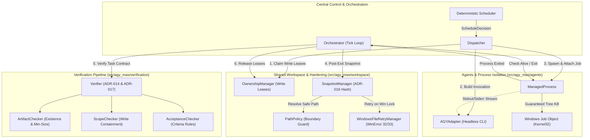
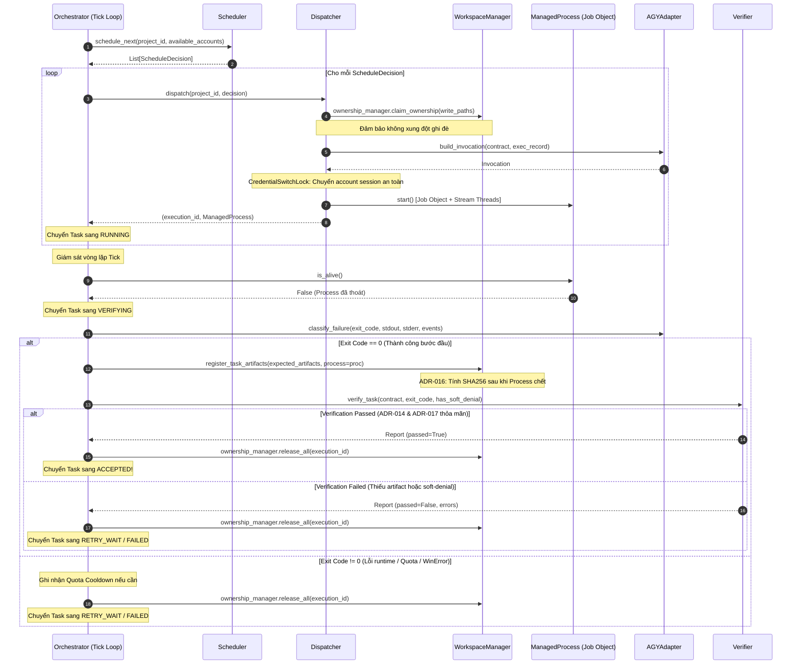

# GIÁO TRÌNH KIẾN TRÚC MULTI-AGENT SYSTEM (MAS) v1.1
# Module 03: Agents Runtime, Workspace Management & Process Isolation trên Windows

---

## 📑 Mục lục
1. [Tổng quan & Mục tiêu đào tạo (Overview & Objectives)](#1-tổng-quan--mục-tiêu-đào-tạo-overview--objectives)
2. [Kiến trúc Tổng thể: Agents - Workspace - Verification Pipeline](#2-kiến-trúc-tổng-thể-agents---workspace---verification-pipeline)
3. [Phân hệ Agent Runtime & Process Supervision (`agents/`)](#3-phân-hệ-agent-runtime--process-supervision-agents)
   - [3.1. Hợp đồng trừu tượng `AgentRuntimeAdapter` & Event Model](#31-hợp-đồng-trừu-tượng-agentruntimeadapter--event-model)
   - [3.2. Giám sát tiến trình cấp thấp & Windows Job Objects (`process_manager.py`)](#32-giám-sát-tiến-trình-cấp-thấp--windows-job-objects-process_managerpy)
   - [3.3. Thu thập Stream bất đồng bộ Non-blocking & Bộ ngắt tiến trình 2 lớp](#33-thu-thập-stream-bất-đồng-bộ-non-blocking--bộ-ngắt-tiến-trình-2-lớp)
   - [3.4. Headless AGY Adapter (`adapters/agy_adapter.py`) & Phân loại lỗi đa tầng](#34-headless-agy-adapter-adaptersagy_adapterpy--phân-loại-lỗi-đa-tầng)
4. [Phân hệ Quản trị Workspace & Windows Hardening (`workspace/`)](#4-phân-hệ-quản-trị-workspace--windows-hardening-workspace)
   - [4.1. Chính sách An toàn Đường dẫn (`path_policy.py`)](#41-chính-sách-an-toàn-đường-dẫn-path_policypy)
   - [4.2. Xử lý Xung đột Khóa File Windows: WinError 32/33 (`file_lock_manager.py`)](#42-xử-lý-xung-đột-khóa-file-windows-winerror-3233-file_lock_managerpy)
   - [4.3. Quản trị Quyền Ghi theo Lease Mẫu Đường dẫn (`ownership_manager.py`)](#43-quản-trị-quyền-ghi-theo-lease-mẫu-đường-dẫn-ownership_managerpy)
   - [4.4. Snapshot Deliverables & Quyết định Kiến trúc ADR-016 (`snapshot_manager.py`)](#44-snapshot-deliverables--quyết-định-kiến-trúc-adr-016-snapshot_managerpy)
   - [4.5. Facade Điều phối Workspace (`workspace_manager.py`)](#45-facade-điều-phối-workspace-workspace_managerpy)
5. [Đường ống Thẩm định & Xác minh Tác vụ Độc lập (`verification/`)](#5-đường-ống-thẩm-định--xác-minh-tác-vụ-độc-lập-verification)
   - [5.1. Triết lý "Exit Code 0 không đồng nghĩa với Thành công"](#51-triết-lý-exit-code-0-không-đồng-nghĩa-với-thành-công)
   - [5.2. Các Bộ kiểm định Chuyên biệt: Artifact, Scope và Acceptance Criteria](#52-các-bộ-kiểm-định-chuyên-biệt-artifact-scope-và-acceptance-criteria)
   - [5.3. Verification Engine: Thực thi ADR-014 và ADR-017](#53-verification-engine-thực-thi-adr-014-và-adr-017)
6. [Phối hợp Điều phối, Đa tài khoản & Tự động Phục hồi](#6-phối-hợp-điều-phối-đa-tài-khoản--tự-động-phục-hồi)
   - [6.1. Sequence Diagram: Vòng đời Thực thi Một Tác vụ](#61-sequence-diagram-vòng-đời-thực-thi-một-tác-vụ)
   - [6.2. Cô lập Tài khoản Đa tiến trình với `CredentialSwitchLock`](#62-cô-lập-tài-khoản-đa-tiến-trình-với-credentialswitchlock)
   - [6.3. Khắc phục Sự cố Sập nguồn & Dọn rác Tiến trình Chết (`recovery/`)](#63-khắc-phục-sự-cố-sập-nguồn--dọn-rác-tiến-trình-chết-recovery)
7. [Ma trận Kiểm thử & Đối sánh Chuẩn Kiến trúc v1.1](#7-ma-trận-kiểm-thử--đối-sánh-chuẩn-kiến-trúc-v11)
8. [Bài tập Thực hành & Kịch bản Tự luyện (Hands-on Labs)](#8-bài-tập-thực-hành--kịch-bản-tự-luyện-hands-on-labs)
9. [Câu hỏi Ôn tập & Hướng dẫn Đọc tiếp](#9-câu-hỏi-ôn-tập--hướng-dẫn-đọc-tiếp)

---

## 1. Tổng quan & Mục tiêu đào tạo (Overview & Objectives)

Hệ thống **Multi-Agent System (MAS)** cho Antigravity được thiết kế để điều phối hàng loạt tác tử AI tự động thực thi song song các tác vụ trong công trình phần mềm. Khi chạy trong môi trường thực tế — đặc biệt là hệ điều hành **Windows** — các hệ thống Multi-Agent thường xuyên đối mặt với bốn thách thức chí mạng:

1. **Xung đột Concurrency & Khóa File Độc quyền Windows (`WinError 32` / `WinError 33`)**: Khác với POSIX cho phép `unlink` hoặc ghi đè trên file đang mở, cơ chế `CreateFileW` của Windows mặc định khóa file độc quyền (exclusive lock). Khi nhiều tác tử đọc/ghi đồng thời hoặc trình biên dịch/linter ngầm kiểm tra file, hệ thống sẽ sụp đổ nếu thiếu cơ chế retry thích nghi.
2. **Tiến trình Mồ côi (Zombie / Leaked Process Trees)**: Khi một tác tử AI khởi chạy các lệnh con (như `npm build`, `pytest`, `cargo`, trình duyệt headless), việc chỉ gọi `subprocess.kill()` chỉ tiêu diệt tiến trình cha ở tầng trên cùng, để lại cả một "cây tiến trình" (process tree) chạy ngầm, chiếm dụng RAM, CPU và khóa chặt file trong workspace.
3. **Ảo tưởng Thành công (False Success & Soft-Denials)**: Một tiến trình CLI có thể trả về `exit_code = 0` nhưng thực chất tác tử AI đã bị chặn bởi cơ chế phân quyền (Soft-Denial), hoặc tác tử chỉ in ra phản hồi văn bản mà quên tạo file artifacts theo hợp đồng.
4. **Tranh chấp Session Xác thực OS**: Khi nhiều tác tử luân phiên dùng các tài khoản Google khác nhau để tránh cạn hạn ngạch (Quota Exhaustion), việc can thiệp vào OS Credential Manager mà thiếu cơ chế khóa đồng bộ mức hệ thống (inter-process synchronization lock) sẽ gây ra tình trạng chiếm đoạt phiên chéo (credential race condition).

```
                      +---------------------------------------+
                      |       AGY-MAS ARCHITECTURE v1.1       |
                      +---------------------------------------+
                                          |
          +-------------------------------+-------------------------------+
          |                               |                               |
          v                               v                               v
+--------------------+          +--------------------+          +--------------------+
|   src/agy_mas/     |          |   src/agy_mas/     |          |   src/agy_mas/     |
|      agents/       |          |     workspace/     |          |   verification/    |
+--------------------+          +--------------------+          +--------------------+
| * Invocation Spec  |          | * Path Policy      |          | * Artifact Checker |
| * Windows Job Obj  |          | * WinError 32/33   |          | * Scope Checker    |
| * Headless Adapter |          | * Path Ownership   |          | * Acceptance Rules |
| * Error Taxonomy   |          | * ADR-016 Snapshot |          | * ADR-014 / ADR-017|
+--------------------+          +--------------------+          +--------------------+
```

### Mục tiêu học tập (Learning Objectives)
Sau khi nghiên cứu module này, học viên có khả năng:
* **Hiểu sâu sắc** cấu trúc và nguyên lý trừu tượng hóa runtime qua lớp [`AgentRuntimeAdapter`](file:///C:/Users/TOAN%20PHUC/Desktop/project/multi-agy-tool/src/agy_mas/agents/base.py#L56-L88).
* **Làm chủ kỹ thuật cô lập tiến trình trên Windows** bằng Windows Job Objects (`JOB_OBJECT_LIMIT_KILL_ON_JOB_CLOSE`) qua `ctypes.WinDLL("kernel32")` trong [`ManagedProcess`](file:///C:/Users/TOAN%20PHUC/Desktop/project/multi-agy-tool/src/agy_mas/agents/process_manager.py#L57-L215).
* **Nắm vững mô hình phân loại lỗi đa tầng** (Error Taxonomy) giữa lỗi có cấu trúc (Structured JSON) và quy tắc mẫu văn bản (Regex Fallback).
* **Giải quyết triệt để lỗi khóa file chia sẻ Windows** thông qua thuật toán Exponential Backoff kèm Random Jitter trong [`WindowsFileRetryManager`](file:///C:/Users/TOAN%20PHUC/Desktop/project/multi-agy-tool/src/agy_mas/workspace/file_lock_manager.py#L32-L60).
* **Phân tích và bảo vệ biên giới Workspace** bằng chính sách ngăn chặn Path Traversal trong [`PathPolicy`](file:///C:/Users/TOAN%20PHUC/Desktop/project/multi-agy-tool/src/agy_mas/workspace/path_policy.py#L12-L47) và cấp phát lease quyền ghi trong [`OwnershipManager`](file:///C:/Users/TOAN%20PHUC/Desktop/project/multi-agy-tool/src/agy_mas/workspace/ownership_manager.py#L15-L88).
* **Thấu suốt các quyết định kiến trúc cốt lõi**:
  * **ADR-009**: Headless print mode (-p) cho thực thi tự động.
  * **ADR-010**: Phân loại lỗi ưu tiên sự kiện có cấu trúc trước pattern fallback.
  * **ADR-013**: Cô lập quyền scoped permissions mặc định, chỉ mở Turbo khi có chỉ định rõ ràng.
  * **ADR-014**: Quyền bị từ chối mềm (Soft-denial) là tín hiệu lỗi thất bại, cấm chấp nhận tác vụ.
  * **ADR-016**: Chỉ snapshot SHA256 sau khi cây tiến trình worker đã thoát hoàn toàn.
  * **ADR-017**: Tác vụ bắt buộc phải qua thẩm định nghiệm thu độc lập (Artifacts Verification) mới được chuyển sang `ACCEPTED`.

---

## 2. Kiến trúc Tổng thể: Agents - Workspace - Verification Pipeline

Mô hình thực thi tác vụ trong `agy-mas` tuân thủ nguyên lý kiểm soát tập trung (Centralized Orchestration). Tác vụ không bao giờ tự ý sửa đổi file mà không có sự bảo hộ của hợp đồng tác vụ (`TaskContract`), không gian làm việc (`WorkspaceManager`) và bộ kiểm tra thẩm định độc lập (`Verifier`).

### Sơ đồ tương tác kiến trúc hệ thống



### Luồng tương tác 6 bước chuẩn hóa
1. **Tiếp nhận quyết định điều phối (`ScheduleDecision`)**: [`Dispatcher`](file:///C:/Users/TOAN%20PHUC/Desktop/project/multi-agy-tool/src/agy_mas/core/dispatcher.py#L18-L109) xác nhận các tác vụ phụ thuộc đã hoàn tất, chuyển trạng thái tác vụ từ `PENDING` sang `CLAIMED`.
2. **Xác lập quyền sở hữu Workspace (Write Leases)**: Trước khi cấp phát CPU, [`OwnershipManager`](file:///C:/Users/TOAN%20PHUC/Desktop/project/multi-agy-tool/src/agy_mas/workspace/ownership_manager.py#L15-L88) kiểm tra xem thư mục đích của tác vụ này có bị trùng lặp với một tác vụ song song khác hay không. Nếu trùng, xung đột được ngăn chặn ngay lập tức.
3. **Đóng gói lệnh & Khởi tạo Tiến trình Cô lập**: [`AGYAdapter`](file:///C:/Users/TOAN%20PHUC/Desktop/project/multi-agy-tool/src/agy_mas/agents/adapters/agy_adapter.py#L19-L256) biên dịch các yêu cầu thành cờ dòng lệnh an toàn. [`ManagedProcess`](file:///C:/Users/TOAN%20PHUC/Desktop/project/multi-agy-tool/src/agy_mas/agents/process_manager.py#L57-L215) khởi chạy tiến trình và lập tức gán handle tiến trình vào Windows Job Object.
4. **Giám sát dòng dữ liệu & Bắt lỗi theo thời gian thực**: Hai worker thread nền liên tục đọc stdout và stderr, phân tích dòng JSON có cấu trúc để phát hiện sớm các sự cố như cạn hạn ngạch (`QUOTA_EXHAUSTED`) hoặc bị từ chối quyền (`PERMISSION_SOFT_DENIED`).
5. **Đảm bảo thoát an toàn & Thu thập Snapshot (ADR-016)**: Khi tiến trình kết thúc hoặc bị hủy, toàn bộ cây tiến trình con bị triệt hạ dứt điểm. Chỉ sau khi tiến trình đã chết hẳn, [`SnapshotManager`](file:///C:/Users/TOAN%20PHUC/Desktop/project/multi-agy-tool/src/agy_mas/workspace/snapshot_manager.py#L16-L57) mới tính toán SHA256 của các file sản phẩm bàn giao (Deliverables).
6. **Kiểm tra Nghiệm thu Độc lập (ADR-014 & ADR-017)**: [`Verifier`](file:///C:/Users/TOAN%20PHUC/Desktop/project/multi-agy-tool/src/agy_mas/verification/verifier.py#L19-L68) rà soát file thực tế trên đĩa, đối chiếu kích thước, kiểm tra vi phạm phạm vi ghi và xác nhận không có bất kỳ soft-denial nào xảy ra. Nếu hợp lệ, tác vụ chính thức chuyển sang trạng thái `ACCEPTED`.

---

## 3. Phân hệ Agent Runtime & Process Supervision (`agents/`)

Thư mục `src/agy_mas/agents` chịu trách nhiệm bao bọc các công cụ AI CLI (như Google Antigravity `agy`) thành một giao diện lập trình hướng đối tượng, an toàn và có thể thay thế được.

```text
src/agy_mas/agents/
├── __init__.py
├── base.py                 # Định nghĩa Interfaces, Dataclasses & Hợp đồng Adapter
├── process_manager.py      # Giám sát tiến trình, Windows Job Objects, Stream Threads
└── adapters/
    ├── __init__.py
    └── agy_adapter.py      # Adapter thực thi Google Antigravity Headless CLI
```

### 3.1. Hợp đồng trừu tượng `AgentRuntimeAdapter` & Event Model

Tại file [`base.py`](file:///C:/Users/TOAN%20PHUC/Desktop/project/multi-agy-tool/src/agy_mas/agents/base.py), lớp trừu tượng [`AgentRuntimeAdapter`](file:///C:/Users/TOAN%20PHUC/Desktop/project/multi-agy-tool/src/agy_mas/agents/base.py#L56-L88) định nghĩa 4 phương thức bắt buộc:

```python
class AgentRuntimeAdapter(ABC):
    @abstractmethod
    def validate_runtime(self) -> RuntimeCapabilities:
        """Kiểm tra sự tồn tại của CLI, phiên bản và các cờ tham số hỗ trợ."""
        pass

    @abstractmethod
    def build_invocation(
        self,
        task_contract: Dict[str, Any],
        execution_record: Dict[str, Any],
        policy: Optional[Dict[str, Any]] = None,
    ) -> Invocation:
        """Biên dịch Task Contract thành cấu trúc gọi dòng lệnh an toàn."""
        pass

    @abstractmethod
    def classify_failure(
        self,
        exit_code: int,
        stdout_tail: str,
        stderr_tail: str,
        events: Optional[List[RuntimeEvent]] = None,
    ) -> FailureClassification:
        """Ánh xạ exit_code và log đầu ra vào bảng phân loại lỗi hệ thống."""
        pass

    @abstractmethod
    def parse_line(self, line: str) -> Optional[RuntimeEvent]:
        """Phân tích một dòng stdout/stderr thành sự kiện có cấu trúc."""
        pass
```

#### Các Data Transfer Objects (DTO) cốt lõi:
* [`RuntimeCapabilities`](file:///C:/Users/TOAN%20PHUC/Desktop/project/multi-agy-tool/src/agy_mas/agents/base.py#L9-L16): Khai báo các năng lực của runtime (như hỗ trợ chế độ in không tương tác `print_mode`, định dạng đầu ra `stream_json`, các model được hỗ trợ).
* [`Invocation`](file:///C:/Users/TOAN%20PHUC/Desktop/project/multi-agy-tool/src/agy_mas/agents/base.py#L19-L25): Đóng gói `command_args` (danh sách tham số dạng list để chống lỗi khoảng trắng đường dẫn trên Windows), biến môi trường `env`, thư mục làm việc hiện tại `cwd` và thời gian timeout.
* [`RuntimeEvent`](file:///C:/Users/TOAN%20PHUC/Desktop/project/multi-agy-tool/src/agy_mas/agents/base.py#L28-L35): Chuẩn hóa các sự kiện phát sinh từ stream của agent (`event_type`, `message`, `error_type`, `structured_payload`).
* [`FailureClassification`](file:///C:/Users/TOAN%20PHUC/Desktop/project/multi-agy-tool/src/agy_mas/agents/base.py#L38-L46): Phản ánh nguyên nhân thất bại, phân loại rõ ràng liệu lỗi có thể thử lại (`retryable`) và có cần thiết lập thời gian chờ (`cooldown_required`) cho tài khoản hay không.
* [`TerminationResult`](file:///C:/Users/TOAN%20PHUC/Desktop/project/multi-agy-tool/src/agy_mas/agents/base.py#L49-L54): Báo cáo kết quả hủy diệt tiến trình (`success`, `processes_terminated`, `residual_processes`).

---

### 3.2. Giám sát tiến trình cấp thấp & Windows Job Objects (`process_manager.py`)

Trên hệ điều hành Windows, khi một tiến trình Python tạo một tiến trình con thông qua `subprocess.Popen`, tiến trình con đó có thể tiếp tục tạo ra nhiều tiến trình cháu (ví dụ: `agy.cmd` gọi `node.exe`, sau đó `node.exe` gọi `python.exe` hoặc `git.exe`). Nếu tiến trình cha bị kết thúc đột ngột (do timeout hoặc người dùng dừng lệnh), các tiến trình cháu sẽ bị cô lập và trở thành **tiến trình mồ côi (Zombie Processes)**.

Để giải quyết tận gốc vấn đề này trên Windows, [`ManagedProcess`](file:///C:/Users/TOAN%20PHUC/Desktop/project/multi-agy-tool/src/agy_mas/agents/process_manager.py#L57-L215) sử dụng trực tiếp **Win32 Kernel Job Objects** qua thư viện `ctypes`:

```
+-------------------------------------------------------------+
|                 Windows Job Object Boundary                 |
|                                                             |
|   +-------------------+                                     |
|   |  ManagedProcess   | (Main Child Process)                |
|   +-------------------+                                     |
|             |                                               |
|             +----------> +-------------------+              |
|             |            | Sub-Process (CLI) |              |
|             |            +-------------------+              |
|             |                      |                        |
|             v                      v                        |
|   +-------------------+  +-------------------+              |
|   |  Node.js Engine   |  | Pytest / Compiler |              |
|   +-------------------+  +-------------------+              |
|                                                             |
|   Cờ: JOB_OBJECT_LIMIT_KILL_ON_JOB_CLOSE (0x00002000)       |
+-------------------------------------------------------------+
                          |
     (Khi Handle Job Object đóng hoặc bị Terminate)
                          v
         TẤT CẢ TIẾN TRÌNH TRONG JOB BỊ HẠ GỤC
```

#### Cơ chế thiết lập Win32 Job Object:
1. **Khởi tạo Job Object**: Gọi hàm `kernel32.CreateJobObjectW(None, None)`.
2. **Cấu hình giới hạn tự sát**: Thiết lập cờ `JOB_OBJECT_LIMIT_KILL_ON_JOB_CLOSE = 0x00002000` trong cấu trúc [`JOBOBJECT_EXTENDED_LIMIT_INFORMATION`](file:///C:/Users/TOAN%20PHUC/Desktop/project/multi-agy-tool/src/agy_mas/agents/process_manager.py#L46-L54). Khi handle của Job Object bị đóng (kể cả khi chương trình điều phối sập nguồn), hệ điều hành Windows sẽ tự động quét sạch mọi tiến trình nằm trong Job Object này.
3. **Gán tiến trình vào Job**: Sau khi gọi `subprocess.Popen`, lấy handle của tiến trình qua `kernel32.OpenProcess(PROCESS_ALL_ACCESS, False, pid)` và đưa vào Job bằng `kernel32.AssignProcessToJobObject(job_handle, proc_handle)`.

```python
# Trích đoạn từ src/agy_mas/agents/process_manager.py
if IS_WINDOWS:
    try:
        self.job_handle = kernel32.CreateJobObjectW(None, None)
        if self.job_handle:
            info = JOBOBJECT_EXTENDED_LIMIT_INFORMATION()
            info.BasicLimitInformation.LimitFlags = JOB_OBJECT_LIMIT_KILL_ON_JOB_CLOSE
            kernel32.SetInformationJobObject(
                self.job_handle,
                JobObjectExtendedLimitInformation,
                ctypes.byref(info),
                ctypes.sizeof(info),
            )
    except Exception:
        self.job_handle = None
```

---

### 3.3. Thu thập Stream bất đồng bộ Non-blocking & Bộ ngắt tiến trình 2 lớp

Để tránh hiện tượng tắc nghẽn I/O (deadlock) khi bộ đệm OS pipe bị đầy (`stdout.read()` hoặc `stderr.read()`), [`ManagedProcess`](file:///C:/Users/TOAN%20PHUC/Desktop/project/multi-agy-tool/src/agy_mas/agents/process_manager.py#L57-L215) khởi chạy hai luồng daemon chuyên biệt: `_read_stdout` và `_read_stderr`.

* Mỗi dòng nhận được sẽ được loại bỏ ký tự ngắt dòng `\r\n` (chuẩn Windows) và lưu trữ trong mảng bộ nhớ.
* Hỗ trợ callback `on_stdout_line` để chuyển tiếp dữ liệu trực tiếp tới TUI hoặc logger.

#### Cơ chế tiêu diệt tiến trình 2 lớp (Two-Layer Defense Termination):
Khi cần dừng một worker (ví dụ: vượt quá `timeout_seconds`), hàm [`terminate_tree()`](file:///C:/Users/TOAN%20PHUC/Desktop/project/multi-agy-tool/src/agy_mas/agents/process_manager.py#L163-L215) thực thi tuần tự:
1. **Lớp 1 (Kernel Level)**: Gọi `kernel32.TerminateJobObject(self.job_handle, 1)`. Thao tác này ngay lập tức bắn tín hiệu hủy tới toàn bộ các tiến trình trong Job.
2. **Lớp 2 (OS Shell Fallback)**: Gọi lệnh `taskkill /F /T /PID <pid>`. Dấu cờ `/T` (Tree Kill) và `/F` (Force) đảm bảo quét lại toàn bộ danh sách tiến trình của hệ điều hành.
3. **Xác nhận trạng thái thoát (Active Verification)**: Vòng lặp chờ tối đa 1.0 giây (`poll()`) để khẳng định tiến trình không còn sống sót (`residual == 0`), sau đó đóng handle với `kernel32.CloseHandle(self.job_handle)`.

---

### 3.4. Headless AGY Adapter (`adapters/agy_adapter.py`) & Phân loại lỗi đa tầng

Lớp [`AGYAdapter`](file:///C:/Users/TOAN%20PHUC/Desktop/project/multi-agy-tool/src/agy_mas/agents/adapters/agy_adapter.py#L19-L256) đảm nhiệm việc cầu nối giữa giao thức nội bộ của hệ thống và Antigravity CLI (`agy`).

#### 1. Biên dịch cờ lệnh dòng lệnh (`build_invocation`):
* **Cú pháp Headless Print Mode (ADR-009)**: Sử dụng cờ `-p "<prompt>"` thay vì chế độ TUI tương tác để tiến trình chạy tự động từ đầu đến cuối mà không yêu cầu nhập phím từ người dùng.
* **Định dạng luồng dữ liệu**: Thêm `--output-format stream-json` để nhận phản hồi theo từng dòng JSON thời gian thực.
* **Mô hình & Mức độ suy luận (Hierarchical Model & Effort)**:
  Thực hiện phân giải theo 3 cấp ưu tiên giảm dần:
  $$\text{Task Contract Parameter} \longrightarrow \text{Execution Record} \longrightarrow \text{Account Profile Metadata} \longrightarrow \text{Policy Default} \longrightarrow \text{"gemini-3.8-flash"}$$
* **Quy tắc an toàn cho `--effort`**:
  > [!IMPORTANT]
  > Cờ `--effort` (`low`, `medium`, `high`, `xhigh`, `max`) **CHỈ ĐƯỢC PHÉP ÁP DỤNG** cho các dòng mô hình Google Gemini (ví dụ: `gemini-3.8-flash`).
  > Đối với các mô hình của bên thứ ba như Claude (`claude-sonnet-4-6`, `claude-opus-4-6-thinking`) và GPT (`gpt-oss-120b-medium`), cơ chế Thinking đã được tích hợp sẵn nguyên bản, việc truyền `--effort` sẽ khiến Antigravity CLI báo lỗi cú pháp và dừng với exit code 1. `AGYAdapter` tự động loại bỏ cờ này nếu không phải mô hình Gemini.
* **Vị trí của cờ `-p`**: Cờ `-p` luôn được đặt ngay sát trước nội dung prompt ở cuối danh sách cờ, ngăn chặn lỗi CLI nuốt mất các tùy chọn đi kèm.

```python
# Trích đoạn logic xây dựng lệnh trong AGYAdapter
effort = params.get("effort") or profile_meta.get("effort") or policy.get("default_effort")
if effort and model and model.startswith("gemini") and effort in ("low", "medium", "high", "xhigh", "max"):
    cmd.extend(["--effort", effort])
```

#### 2. Phân loại lỗi theo bảng phân loại (Section 10 Error Taxonomy):
Hàm [`classify_failure()`](file:///C:/Users/TOAN%20PHUC/Desktop/project/multi-agy-tool/src/agy_mas/agents/adapters/agy_adapter.py#L172-L256) phân loại lỗi theo 2 giai đoạn ưu tiên (ADR-010):

| Thứ tự | Nguồn phát hiện | Dấu hiệu nhận diện | Phân loại `error_type` | Có thể Retry? | Yêu cầu Cooldown? |
|:---:|:---|:---|:---|:---:|:---:|
| **1** | **Structured Event** (Ưu tiên số 1) | `ev.error_type == 'QUOTA_EXHAUSTED'` | `QUOTA_EXHAUSTED` | **Có** (`True`) | **Có** (5 giờ = 18000s) |
| **1** | **Structured Event** (Ưu tiên số 1) | `ev.error_type == 'PERMISSION_SOFT_DENIED'` | `PERMISSION_SOFT_DENIED` | **Không** (`False`) | **Không** (`False`) |
| **2** | **Regex / Text Pattern** | `"quota exceeded"`, `"resource_exhausted"`, `"429"` | `QUOTA_EXHAUSTED` | **Có** (`True`) | **Có** (5 giờ = 18000s) |
| **2** | **Regex / Text Pattern** | `"rate limit"`, `"too many requests"` | `RATE_LIMITED` | **Có** (`True`) | **Có** (60s) |
| **2** | **Regex / Text Pattern** | `"unauthorized"`, `"credential"`, `"invalid_token"` | `AUTHENTICATION_FAILED` | **Không** (`False`) | **Có** |
| **2** | **Regex / Text Pattern** | `"permission denied"`, `"access denied"` | `PERMISSION_SOFT_DENIED` | **Không** (`False`) | **Không** (`False`) |
| **2** | **Regex / Text Pattern** | `"winerror 32"`, `"winerror 33"`, `"file is being used"` | `FILE_BUSY` | **Có** (`True`) | **Không** (`False`) |
| **3** | **Exit Code Fallback** | `exit_code != 0` không trùng khớp mẫu trên | `UNKNOWN_RUNTIME_FAILURE` | **Không** (`False`) | **Không** (`False`) |

---

## 4. Phân hệ Quản trị Workspace & Windows Hardening (`workspace/`)

Thư mục `src/agy_mas/workspace` cung cấp lớp bảo vệ vững chắc cho hệ thống tập tin, ngăn chặn tình trạng ghi đè lẫn nhau, vi phạm bảo mật đường dẫn và xung đột I/O trên Windows.

```text
src/agy_mas/workspace/
├── __init__.py
├── path_policy.py          # Cô lập đường dẫn, phòng thủ Path Traversal
├── file_lock_manager.py    # Xử lý WinError 32/33 bằng Exponential Backoff & Jitter
├── ownership_manager.py    # Quản lý Lease quyền ghi theo mẫu đường dẫn (Path Lease)
├── snapshot_manager.py     # Tính Checksum SHA256 Deliverables sau khi tiến trình thoát (ADR-016)
└── workspace_manager.py    # Facade kết hợp các thành phần của Workspace
```

### 4.1. Chính sách An toàn Đường dẫn (`path_policy.py`)

Khi tác tử AI sinh code hoặc đọc tài nguyên, mã độc hoặc sai sót từ prompt có thể khiến agent thao tác trên các đường dẫn nhạy cảm bên ngoài dự án (ví dụ: `../../Windows/System32` hoặc `C:\Users\...\.ssh`).

Lớp [`PathPolicy`](file:///C:/Users/TOAN%20PHUC/Desktop/project/multi-agy-tool/src/agy_mas/workspace/path_policy.py#L12-L47) thiết lập biên giới cô lập tuyệt đối:
* **Chuẩn hóa tuyệt đối**: Mọi đường dẫn đầu vào đều được đưa qua hàm `.resolve()` của thư viện `pathlib` để loại bỏ các ký tự dấu chấm `.` và `..`.
* **Kiểm tra biên giới**: Sử dụng phương thức `resolved.is_relative_to(self.workspace_root)`. Nếu đường dẫn nằm ngoài thư mục gốc, hệ thống lập tức ném ra ngoại lệ [`PathPolicyError`](file:///C:/Users/TOAN%20PHUC/Desktop/project/multi-agy-tool/src/agy_mas/workspace/path_policy.py#L7-L9).
* **Chuẩn hóa chuỗi hiển thị**: Phương thức [`get_relative_path()`](file:///C:/Users/TOAN%20PHUC/Desktop/project/multi-agy-tool/src/agy_mas/workspace/path_policy.py#L43-L47) luôn chuyển đổi dấu gạch chéo ngược `\` của Windows thành dấu `/` chuẩn mực để lưu trong CSDL SQLite và hiển thị nhất quán.

---

### 4.2. Xử lý Xung đột Khóa File Windows: WinError 32/33 (`file_lock_manager.py`)

#### Bản chất kỹ thuật của `WinError 32` & `WinError 33`:
* **`WinError 32` (`ERROR_SHARING_VIOLATION`)**: Xảy ra khi một tiến trình cố gắng mở hoặc ghi vào một file đang được mở bởi một tiến trình khác mà không có cờ chia sẻ tương thích (`FILE_SHARE_READ`, `FILE_SHARE_WRITE`).
* **`WinError 33` (`ERROR_LOCK_VIOLATION`)**: Xảy ra khi một tiến trình cố gắng truy cập vào một vùng byte cụ thể của file đã bị khóa độc quyền bởi tiến trình khác (`LockFileEx`).

#### Giải pháp trong `WindowsFileRetryManager`:
Để ngăn ngừa thảm họa các tiến trình đồng loạt thử lại cùng một lúc gây nghẽn tiếp (Thundering Herd Problem), [`WindowsFileRetryManager`](file:///C:/Users/TOAN%20PHUC/Desktop/project/multi-agy-tool/src/agy_mas/workspace/file_lock_manager.py#L32-L60) triển khai thuật toán **Exponential Backoff kết hợp Random Jitter**:

$$\text{delay} = \min\Big(\text{max\_delay\_ms},\; \text{delay\_ms} \times 2^{k} \times (1 + \text{jitter})\Big)$$

Trong đó:
* $\text{initial\_delay\_ms} = 100\text{ms}$
* $\text{max\_delay\_ms} = 1500\text{ms}$
* $\text{max\_attempts} = 5$ lần thử
* $\text{jitter} \in [-\text{jitter\_ratio},\; +\text{jitter\_ratio}]$ với $\text{jitter\_ratio} = 0.2$ (biến thiên ngẫu nhiên $\pm 20\%$).

```python
# Trích đoạn thuật toán Backoff with Jitter
jitter = (random.random() * 2 - 1) * self.config.jitter_ratio
actual_delay_ms = min(self.config.max_delay_ms, delay_ms * (1 + jitter))
time.sleep(actual_delay_ms / 1000.0)
delay_ms = min(self.config.max_delay_ms, delay_ms * 2)
```

Nếu sau 5 lần thử mà lỗi khóa file vẫn tồn tại, hệ thống sẽ ném ra ngoại lệ [`FileSharingContentionError`](file:///C:/Users/TOAN%20PHUC/Desktop/project/multi-agy-tool/src/agy_mas/workspace/file_lock_manager.py#L13-L15) để kích hoạt cơ chế retry ở tầng điều phối tác vụ. Lớp này cũng cung cấp sẵn decorator `@windows_file_retry` tiện lợi cho các hàm I/O.

---

### 4.3. Quản trị Quyền Ghi theo Lease Mẫu Đường dẫn (`ownership_manager.py`)

Một trong những nguyên nhân hàng đầu khiến các hệ thống multi-agent làm hỏng mã nguồn là **ghi đè chéo (Write Collisions)**: Agent A đang sửa `src/models/user.py` thì Agent B cũng nhảy vào sửa `src/models/user.py` cùng lúc.

[`OwnershipManager`](file:///C:/Users/TOAN%20PHUC/Desktop/project/multi-agy-tool/src/agy_mas/workspace/ownership_manager.py#L15-L88) thiết lập mô hình **Lease-based Path Locking** (Cấp quyền sở hữu theo hạn mức thời gian):

```
Execution E1: Cấp quyền "src/auth/*" (Expires in 900s)
Execution E2: Yêu cầu quyền "src/auth/login.py"

           [Kiểm tra So khớp Mẫu: fnmatch + Prefix check]
                                  |
                                  v
    XUNG ĐỘT PHÁT HIỆN! -> Ném Ngoại lệ OwnershipConflictError!
    Execution E2 bị chặn lại ngay từ tầng lập lịch, bảo vệ an toàn Workspace!
```

#### Quy tắc kiểm tra xung đột:
Khi một Execution yêu cầu quyền ghi cho mẫu `path_pattern`, hệ thống đối chiếu với toàn bộ các lease còn hạn (`expires_at > NOW`) trong dự án. Hai mẫu đường dẫn bị coi là xung đột nếu:
1. `pattern_1 == pattern_2` (Trùng khớp hoàn toàn).
2. `fnmatch(pattern_1, pattern_2)` hoặc `fnmatch(pattern_2, pattern_1)` (Khớp qua wildcard `*`).
3. Một trong hai mẫu là tiền tố thư mục con của mẫu kia (`pattern_1.startswith(pattern_2 + "/")`).

Khi tác vụ hoàn thành (dù thành công hay thất bại), Orchestrator sẽ gọi [`release_all(execution_id)`](file:///C:/Users/TOAN%20PHUC/Desktop/project/multi-agy-tool/src/agy_mas/workspace/ownership_manager.py#L87-L88) để giải phóng toàn bộ lease cho các tác vụ tiếp theo.

---

### 4.4. Snapshot Deliverables & Quyết định Kiến trúc ADR-016 (`snapshot_manager.py`)

> [!CAUTION]
> **Quyết định Kiến trúc ADR-016**:
> *Chỉ tính toán Checksum SHA256 của Deliverables sau khi Cây tiến trình Worker đã thoát hoàn toàn.*

#### Vì sao quy tắc này sống còn?
1. **Bộ đệm I/O chưa được xả (Unflushed Buffers)**: Nhiều công cụ và trình biên dịch chỉ xả dữ liệu từ bộ đệm RAM xuống đĩa cứng khi tiến trình nhận tín hiệu đóng handle. Nếu chụp snapshot khi tiến trình còn sống, file có thể bị thiếu dữ liệu, dẫn đến checksum SHA256 sai lệch hoàn toàn.
2. **Xung đột Khóa Đọc trên Windows**: Nếu tiến trình AI vẫn đang mở file ở chế độ ghi (`w+`), việc snapshot manager cố mở file ở chế độ đọc (`rb`) sẽ kích hoạt ngay lập tức `WinError 32`.

Trong [`SnapshotManager.snapshot_file()`](file:///C:/Users/TOAN%20PHUC/Desktop/project/multi-agy-tool/src/agy_mas/workspace/snapshot_manager.py#L23-L57):
```python
if process and hasattr(process, "is_alive") and process.is_alive():
    raise SnapshotTimingError(
        f"Cannot snapshot '{relative_path}': process tree is still running. "
        "ADR-016 requires process-tree exit before workspace snapshot."
    )
```

Sau khi xác nhận tiến trình đã thoát, thuật toán đọc file theo từng khối 64KB (`chunk := f.read(65536)`), bọc trong bộ retry `WindowsFileRetryManager` để đảm bảo ngay cả khi các tiện ích nền (như Windows Search Indexer hay Defender) đang quét file, quá trình tính hash vẫn diễn ra trơn tru.

---

### 4.5. Facade Điều phối Workspace (`workspace_manager.py`)

[`WorkspaceManager`](file:///C:/Users/TOAN%20PHUC/Desktop/project/multi-agy-tool/src/agy_mas/workspace/workspace_manager.py#L14-L61) đóng vai trò là điểm tiếp xúc duy nhất (Facade) tích hợp toàn bộ các năng lực:
* `path_policy`: Đảm bảo mọi đường dẫn đều hợp lệ và an toàn.
* `retry_manager`: Bảo vệ các thao tác file trước lỗi khóa Windows.
* `ownership_manager`: Quản lý tranh chấp ghi đè.
* `snapshot_manager`: Thu thập bằng chứng artifacts.
* `register_task_artifacts()`: Tự động snapshot toàn bộ danh sách `expected_artifacts` của tác vụ sau khi worker kết thúc và lưu bền vững vào bảng `artifacts` trong CSDL SQLite.

---

## 5. Đường ống Thẩm định & Xác minh Tác vụ Độc lập (`verification/`)

Thư mục `src/agy_mas/verification` đóng vai trò là "Thẩm phán độc lập" trong hệ thống MAS. Tác tử AI không thể tự nhận mình đã hoàn thành; mọi kết quả đều phải vượt qua bộ lọc khắt khe của pipeline này.

```text
src/agy_mas/verification/
├── __init__.py
├── artifact_checker.py    # Kiểm tra sự tồn tại và kích thước tối thiểu của Artifacts
├── scope_checker.py       # Kiểm tra vi phạm phạm vi ghi (Out-of-scope write detection)
├── acceptance_checker.py  # Đánh giá các tiêu chí nghiệm thu khai báo trong hợp đồng
└── verifier.py            # Nhạc trưởng kiểm định toàn diện (Thực thi ADR-014 & ADR-017)
```

### 5.1. Triết lý "Exit Code 0 không đồng nghĩa với Thành công"

Trong lập trình dòng lệnh truyền thống, `exit_code == 0` biểu thị một lệnh kết thúc thành công. Tuy nhiên, đối với LLM-based Agent, điều này hoàn toàn sai lầm:
* Agent có thể in ra: *"Tôi không có quyền sửa file này nên tôi dừng lại"* -> CLI trả về `0` (vì CLI không bị crash), nhưng mục tiêu công việc chưa hề được thực hiện!
* Agent có thể quên tạo file deliverable hoặc chỉ tạo ra một file rỗng 0 bytes -> CLI vẫn thoát với mã `0`.

Hệ thống `agy-mas` áp dụng hai quyết định kiến trúc cốt lõi:
1. **ADR-014**: **Soft-denial trong Headless execution là một Failure Signal**. Nếu agent gặp phải từ chối quyền mềm từ công cụ (ví dụ: công cụ ghi file bị từ chối do chính sách bảo mật), tác vụ **BẮT BUỘC BỊ TỪ CHỐI**, không được phép chuyển sang trạng thái thành công dù exit code là 0.
2. **ADR-017**: **Chấp nhận tác vụ yêu cầu xác minh Artifacts nghiêm ngặt**. Một tác vụ chỉ được coi là `ACCEPTED` khi toàn bộ artifacts cam kết trong hợp đồng xuất hiện thực tế trên đĩa cứng và thỏa mãn tiêu chuẩn kích thước tối thiểu.

---

### 5.2. Các Bộ kiểm định Chuyên biệt: Artifact, Scope và Acceptance Criteria

#### 1. `ArtifactChecker` ([artifact_checker.py](file:///C:/Users/TOAN%20PHUC/Desktop/project/multi-agy-tool/src/agy_mas/verification/artifact_checker.py))
Duyệt qua từng `ExpectedArtifact` được chỉ định trong hợp đồng:
* Kiểm tra đường dẫn an toàn qua `PathPolicy`.
* Kiểm tra sự tồn tại trên ổ đĩa vật lý: Nếu `required=True` mà file không tồn tại -> Báo lỗi.
* Xác nhận định dạng: Phải là một file thông thường (`is_file()`), không chấp nhận thư mục.
* Kiểm tra kích thước dữ liệu: `actual_size >= exp.min_size_bytes`. Quy tắc này ngăn chặn triệt để tình trạng agent tạo ra file "ma" rỗng 0 bytes để gian lận nghiệm thu.

#### 2. `ScopeChecker` ([scope_checker.py](file:///C:/Users/TOAN%20PHUC/Desktop/project/multi-agy-tool/src/agy_mas/verification/scope_checker.py))
Duyệt qua danh sách các file mà worker đã chạm vào (`touched_relative_paths`). Đối chiếu với cấu hình `permission_profile.write_paths`:
* Nếu phát hiện agent chỉnh sửa hoặc tạo mới file nằm ngoài phạm vi đã đăng ký (ví dụ: task frontend đi sửa đổi file trong `backend/`), `ScopeChecker` lập tức gắn cờ vi phạm:
  $$\text{Out-of-scope write detected: 'path' is not covered by task write paths}$$

#### 3. `AcceptanceChecker` ([acceptance_checker.py](file:///C:/Users/TOAN%20PHUC/Desktop/project/multi-agy-tool/src/agy_mas/verification/acceptance_checker.py))
Thẩm định danh sách các luật nghiệm thu động `AcceptanceCriterion`:
* `EXIT_CODE_ZERO`: Đòi hỏi exit code bắt buộc bằng 0.
* `NO_SOFT_DENIAL`: Đòi hỏi cờ `has_soft_denial == False`.
* `ARTIFACT_EXISTS`: Đòi hỏi file chỉ định trong tham số `params["path"]` phải tồn tại.

---

### 5.3. Verification Engine: Thực thi ADR-014 và ADR-017

Lớp [`Verifier`](file:///C:/Users/TOAN%20PHUC/Desktop/project/multi-agy-tool/src/agy_mas/verification/verifier.py#L19-L68) điều phối toàn bộ pipeline kiểm tra qua phương thức [`verify_task()`](file:///C:/Users/TOAN%20PHUC/Desktop/project/multi-agy-tool/src/agy_mas/verification/verifier.py#L28-L68):

```python
def verify_task(
    self,
    contract: TaskContract,
    exit_code: int,
    has_soft_denial: bool,
    touched_paths: Optional[List[str]] = None,
) -> VerificationReport:
    errors: List[str] = []

    # 1. Thẩm định Soft-denial (ADR-014)
    if has_soft_denial:
        errors.append("Task cannot be accepted: Permission soft denial was detected in headless mode.")

    # 2. Thẩm định Exit Code
    if exit_code != 0:
        errors.append(f"Task process failed with exit code {exit_code}.")

    # 3. Thẩm định Deliverable Artifacts (ADR-017)
    art_ok, art_errors = self.artifact_checker.check_artifacts(contract.outputs.expected_artifacts)
    if not art_ok:
        errors.extend(art_errors)

    # 4. Thẩm định Ranh giới Phạm vi Ghi
    if touched_paths:
        scope_ok, scope_errors = self.scope_checker.check_paths(touched_paths)
        if not scope_ok:
            errors.extend(scope_errors)

    # 5. Thẩm định Tiêu chí Nghiệm thu Khai báo
    crit_ok, crit_errors = self.acceptance_checker.evaluate(
        contract.acceptance_criteria, exit_code, has_soft_denial
    )
    if not crit_ok:
        errors.extend(crit_errors)

    return VerificationReport(
        passed=(len(errors) == 0),
        errors=errors,
        artifacts_verified=len(contract.outputs.expected_artifacts),
    )
```

Chỉ khi `report.passed == True`, tác vụ mới được phép chuyển từ `VERIFYING` sang `ACCEPTED`. Nếu có bất kỳ lỗi nào, tác vụ sẽ bị đánh dấu `FAILED` hoặc đưa vào hàng đợi `RETRY_WAIT`.

---

## 6. Phối hợp Điều phối, Đa tài khoản & Tự động Phục hồi

### 6.1. Sequence Diagram: Vòng đời Thực thi Một Tác vụ

Biểu đồ tuần tự dưới đây thể hiện chính xác sự phối hợp giữa Orchestrator, Dispatcher, Process Manager, Workspace Manager và Verifier:



---

### 6.2. Cô lập Tài khoản Đa tiến trình với `CredentialSwitchLock`

Trong môi trường Windows, Google Antigravity CLI lưu token đăng nhập trong OS Credential Manager (thông qua Windows DPAPI hoặc tập tin `credentials.json`). Khi chạy nhiều tác tử song song với các tài khoản Google khác nhau:
* Nếu Agent 1 đang chuyển token sang `Account_A` và chưa kịp khởi động CLI, mà Agent 2 nhảy vào ghi đè token của `Account_B`, Agent 1 sẽ bị nhầm lẫn danh tính hoặc vướng lỗi `Authentication required`.

Giải pháp trong [`CredentialSwitchLock`](file:///C:/Users/TOAN%20PHUC/Desktop/project/multi-agy-tool/src/agy_mas/accounts/credential_provider.py#L39-L86):
* Sử dụng một file khóa cấp hệ điều hành: `~/.gemini/antigravity-cli/credential_switch.lock`.
* Trên Windows, áp dụng cơ chế khóa byte cấp thấp của thư viện `msvcrt.locking(fd, msvcrt.LK_NBLCK, 1)`.
* **Staggered Startup Delay (0.4s)**: Sau khi nạp session của tài khoản và khởi chạy subprocess, Dispatcher giữ khóa thêm 400ms để CLI nạp xong token vào bộ nhớ RAM trước khi nhả khóa cho tác tử tiếp theo:

```python
# Trích đoạn điều phối an toàn trong Dispatcher
with CredentialSwitchLock():
    if decision.account_id:
        switch_credential_to_account(decision.account_id)
    process = ManagedProcess(invocation)
    process.start()
    if decision.account_id:
        time.sleep(0.4)  # Grace period chống race condition
```

---

### 6.3. Khắc phục Sự cố Sập nguồn & Dọn rác Tiến trình Chết (`recovery/`)

Nếu máy tính mất điện hoặc tiến trình daemon chính bị tắt đột ngột (`SIGKILL`), CSDL SQLite vẫn có thể lưu trữ các tác vụ ở trạng thái `RUNNING` cùng các bản ghi khóa tài nguyên `resource_locks` và `file_ownerships` bị bỏ rơi (Orphaned Locks).

Lớp [`RecoveryManager`](file:///C:/Users/TOAN%20PHUC/Desktop/project/multi-agy-tool/src/agy_mas/recovery/recovery_manager.py) triển khai thuật toán **Startup Reconciliation (Phục hồi lúc Khởi động)**:
1. Quét toàn bộ các tác vụ đang mang cờ `RUNNING` hoặc `CLAIMED`.
2. Truy xuất PID của tiến trình từ bảng `executions`.
3. Kiểm tra xem PID đó có còn sống thực sự trên Windows hay không:
   ```python
   # Windows PID aliveness probe
   kernel32.OpenProcess(PROCESS_QUERY_LIMITED_INFORMATION, False, pid)
   ```
4. Nếu PID đã chết:
   * Chuyển trạng thái execution sang `INTERRUPTED` với mã lỗi `INTERRUPTED_CRASH`.
   * Reset trạng thái task về `READY` để sẵn sàng được Scheduler lập lịch lại.
   * Xóa sạch toàn bộ các khóa tài nguyên và quyền sở hữu file mồ côi liên quan đến execution đó.

---

## 7. Ma trận Kiểm thử & Đối sánh Chuẩn Kiến trúc v1.1

Bộ kiểm thử của hệ thống bao gồm **37 bài test tự động** đạt tỷ lệ thành công 100%. Dưới đây là ma trận đối chiếu giữa các yêu cầu kiến trúc và các ca kiểm thử tương ứng:

| Mã Chuẩn | Tên Kiểm thử & Kịch bản Nghiệm thu | File Test Nguồn | Hành vi Hệ thống Đạt chuẩn |
|:---:|:---|:---|:---|
| **VER-01** | *Exit 0 with Soft-Denial*<br>Tiến trình trả về 0 nhưng bị từ chối quyền trong luồng stream | [`test_e2e_acceptance.py`](file:///C:/Users/TOAN%20PHUC/Desktop/project/multi-agy-tool/tests/integration/test_e2e_acceptance.py#L108-L126) | `Verifier` phát hiện soft-denial, từ chối nghiệm thu (`passed=False`), ngăn chặn false-positive. |
| **VER-02** | *Missing Output Artifact*<br>Tiến trình trả về 0 nhưng thiếu file sản phẩm trên đĩa | [`test_e2e_acceptance.py`](file:///C:/Users/TOAN%20PHUC/Desktop/project/multi-agy-tool/tests/integration/test_e2e_acceptance.py#L127-L146) | `ArtifactChecker` báo lỗi thiếu deliverable, task bị đánh rớt verification. |
| **VER-03** | *Complete Acceptance Criteria*<br>Toàn bộ tiêu chí đạt chuẩn | [`test_e2e_acceptance.py`](file:///C:/Users/TOAN%20PHUC/Desktop/project/multi-agy-tool/tests/integration/test_e2e_acceptance.py#L147-L176) | Exit code 0, không soft-denial, artifacts đầy đủ kích thước -> Chuyển sang `ACCEPTED`. |
| **QUOTA-01**| *Cooldown & Failover*<br>Tài khoản cạn hạn ngạch khi đang điều phối | [`test_e2e_acceptance.py`](file:///C:/Users/TOAN%20PHUC/Desktop/project/multi-agy-tool/tests/integration/test_e2e_acceptance.py#L177-L189) | Bắt lỗi cấu trúc, kích hoạt cooldown 18000s cho cặp `(acc, model)`, tự động failover sang acc kế tiếp. |
| **WIN-01** | *Windows File Sharing Backoff*<br>Xung đột khóa file `WinError 32` tạm thời | [`test_e2e_acceptance.py`](file:///C:/Users/TOAN%20PHUC/Desktop/project/multi-agy-tool/tests/integration/test_e2e_acceptance.py#L190-L206) | `WindowsFileRetryManager` tự động retry với backoff + jitter và đọc thành công dữ liệu ở lần thử kế tiếp. |
| **REC-01** | *Startup Crash Recovery*<br>Tiến trình bị sập nguồn để lại Dead PID | [`test_e2e_acceptance.py`](file:///C:/Users/TOAN%20PHUC/Desktop/project/multi-agy-tool/tests/integration/test_e2e_acceptance.py#L207-L230) | `RecoveryManager` quét sạch Dead PID, giải phóng resource lock mồ côi và trả task về `READY`. |
| **ADR-016**| *Post-Exit Snapshot Timing*<br>Cố tình snapshot khi process còn sống | [`test_workspace.py`](file:///C:/Users/TOAN%20PHUC/Desktop/project/multi-agy-tool/tests/unit/test_workspace.py#L115-L142) | `SnapshotManager` chặn đứng hành vi và ném ngoại lệ `SnapshotTimingError`. |
| **SAFE-01**| *Path Traversal Prevention*<br>Đường dẫn cố tình thoát workspace (`../../`) | [`test_workspace.py`](file:///C:/Users/TOAN%20PHUC/Desktop/project/multi-agy-tool/tests/unit/test_workspace.py#L57-L66) | `PathPolicy` phát hiện đường dẫn vượt cấp và ném `PathPolicyError`. |

---

## 8. Bài tập Thực hành & Kịch bản Tự luyện (Hands-on Labs)

### Lab 1: Thử nghiệm Cơ chế Tự sát của Windows Job Objects
**Mục tiêu**: Tận mắt chứng kiến Windows Job Object tiêu diệt toàn bộ cây tiến trình con cháu khi tiến trình cha bị dừng.
1. Tạo một script Python con [`child_tree.py`](file:///C:/Users/TOAN%20PHUC/Desktop/project/multi-agy-tool/scratch/child_tree.py) có nhiệm vụ gọi thêm một tiến trình cháu (chẳng hạn lệnh `ping 127.0.0.1 -n 60`).
2. Khởi chạy `child_tree.py` bằng lớp [`ManagedProcess`](file:///C:/Users/TOAN%20PHUC/Desktop/project/multi-agy-tool/src/agy_mas/agents/process_manager.py#L57-L215).
3. Mở Task Manager hoặc PowerShell (`Get-Process ping`) để thấy cả hai tiến trình đang chạy.
4. Gọi `proc.terminate_tree()`.
5. Kiểm tra lại Task Manager: Xác nhận cả `python.exe` và `ping.exe` đều đã biến mất hoàn toàn mà không còn bất kỳ tiến trình rác nào.

---

### Lab 2: Mô phỏng Xung đột Khóa File `WinError 32` & Kiểm chứng Jitter
**Mục tiêu**: Xây dựng đoạn mã mô phỏng xung đột mở file độc quyền trên Windows.
1. Viết script mở file `test_shared.txt` ở chế độ ghi nhị phân độc quyền bằng Windows API hoặc `open("test_shared.txt", "w")`.
2. Tạo luồng thứ hai sử dụng [`WindowsFileRetryManager`](file:///C:/Users/TOAN%20PHUC/Desktop/project/multi-agy-tool/src/agy_mas/workspace/file_lock_manager.py#L32-L60) để đọc file đó.
3. Cấu hình luồng 1 tự động nhả file sau 300ms.
4. Quan sát log của luồng 2: Xác nhận cơ chế backoff tự động ngủ các khoảng thời gian có biến thiên jitter (ví dụ: 108ms, 214ms...) và đọc file thành công mà không gây crash ứng dụng.

---

### Lab 3: Thiết lập Pipeline Xác minh cho Tác vụ Sinh Code
**Mục tiêu**: Tạo một `TaskContract` yêu cầu sinh ra file mã nguồn và dùng `Verifier` để kiểm định.
1. Tạo một hợp đồng:
   * Deliverable: `src/utils/math_helper.py`
   * `min_size_bytes`: 50
   * Tiêu chí: `EXIT_CODE_ZERO`, `NO_SOFT_DENIAL`.
2. Thử nghiệm trường hợp 1: Tạo file nhưng kích thước chỉ có 20 bytes -> Chạy `Verifier.verify_task()` và ghi nhận lỗi kích thước không đạt.
3. Thử nghiệm trường hợp 2: Bổ sung code cho file đạt 100 bytes -> Chạy lại và ghi nhận `VerificationReport.passed == True`.

---

## 9. Câu hỏi Ôn tập & Hướng dẫn Đọc tiếp

### Câu hỏi Ôn tập Kiến thức (Self-Check Questions)
1. *Tại sao việc chỉ dùng `subprocess.Popen.kill()` trên Windows lại không đủ để dọn dẹp tiến trình của các tác tử AI? Windows Job Objects giải quyết vấn đề này như thế nào?*
2. *Trình bày sự khác biệt giữa `WinError 32` và `WinError 33`. Tại sao thuật toán Retry bắt buộc phải có thêm thành phần "Random Jitter"?*
3. *Phân tích lý do kiến trúc đằng sau quyết định ADR-016: Vì sao tuyệt đối không được tính SHA256 của artifact khi tiến trình worker còn sống?*
4. *Nếu một agent hoàn thành công việc với exit code 0 nhưng trong stdout xuất hiện chuỗi `"Permission soft-denial for edit_file"`, hệ thống MAS sẽ xử lý như thế nào theo quyết định ADR-014?*
5. *Giải thích cách `CredentialSwitchLock` bảo vệ trạng thái của Windows Credential Manager khi hệ thống điều phối song song 4 tác tử dùng 4 tài khoản khác nhau.*

### Tài liệu Đọc tiếp đề xuất:
* **Module 04: Central Scheduling, DAG Dependency Graph & Multi-Account Orchestration** (Tìm hiểu thuật toán Kahn's Topological Sort và vòng lặp `Orchestrator.tick()`).
* **Module 05: Crash Recovery, Monotonic Event Logging & SQLite Storage Architecture** (Tìm hiểu cơ chế SQLite WAL mode, PRAGMA busy_timeout và bảo toàn trạng thái bất biến).

---
*Tài liệu thuộc bộ giáo trình kỹ thuật chuẩn hóa cho Antigravity Multi-Agent System (AGY-MAS v1.1).*
